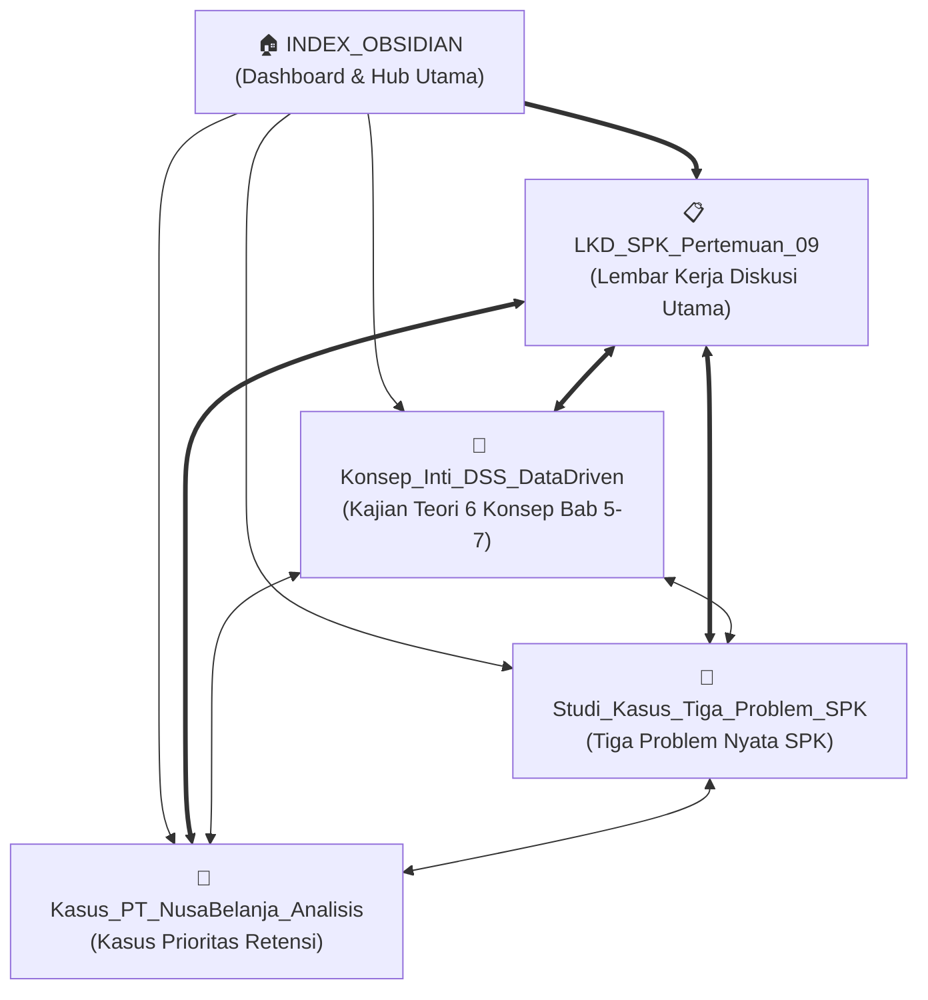

# 📚 Dashboard Vault Obsidian: Sistem Pendukung Keputusan (Pertemuan 09)
*Mata Kuliah: Teori Sistem Pendukung Keputusan — Semester 5 (FT UNY)*  
*Topik: Data-Driven & Intelligent Decision Support (Data Mining, Artificial Neural Networks, Text & Web Mining)*

---

> [!tip] Selamat Datang di Vault Obsidian Teori SPK
> Berkas-berkas di dalam vault ini telah dikonfigurasi secara native untuk **Obsidian**, lengkap dengan *YAML Frontmatter*, *Wikilinks `[[...]]`*, *Obsidian Callouts*, *Mermaid Process Graphs*, serta format matriks tabel LKD resmi Fakultas Teknik UNY.

---

## 🗺️ Peta Konsep dan Jejaring Berkas (Map of Content / MOC)

---

## 📂 Daftar Berkas dan Ringkasan Konten

### 1. `[[LKD_SPK_Pertemuan_09|📋 LKD_SPK_Pertemuan_09.md]]`
**Dokumen Utama Lembar Kerja Diskusi (LKD)** sesuai template resmi `Template - LKD_SPK (4).docx`.
- **Bagian A**: Identitas Pertemuan dan Kelompok.
- **Bagian B (Kesiapan & Pemahaman Awal)**: Diisi lengkap dengan **6 Konsep Utama** (CRISP-DM, Predictive vs Descriptive, ANN & Black-Box, Text Mining, Web Usage Mining, Method Fit) beserta Definisi Singkat, Hubungan dengan DSS/Keputusan (Tabel 3), serta Catatan Awal & 4 Poin Kritis Klarifikasi Diskusi (Tabel 4).
- **Bagian C**: Ringkasan Kasus Diskusi Utama PT NusaBelanja.
- **Bagian D**: Analisis Inti DSS (Tabel 7: Benang Merah 12 Elemen Inti DSS dari Problem hingga Monitoring).
- **Bagian E**: Penerapan 6 Elemen Khusus Topik pada Kasus PT NusaBelanja (Tabel 8).
- **Bagian F**: Analisis Mendalam Sesuai Perspektif Kelompok (Tabel 10).
- **Bagian G**: Kesimpulan dan Rekomendasi Kelompok (Tabel 11: Kesimpulan $\le 100$ kata, Rekomendasi, Keyakinan Tinggi, Alasan, Data Tambahan).

---

### 2. `[[LKD_SPK_Pertemuan_10|📋 LKD_SPK_Pertemuan_10.md]]`
**Dokumen Utama Lembar Kerja Diskusi (LKD) Pertemuan 10: Gudang Data untuk DSS**
- **Tema & Bahan**: Turban Bab 8 (Gudang Data / Data Warehouse).
- **Perspektif**: **Perspektif D (Critical Evaluation — Risk & Limitation Review)**.
- **Studi Kasus**: PT JelajahNusa Travel (Masalah Silo Data Omnichannel, Inkonsistensi Definisi Pelanggan Aktif, Duplikasi Customer, dan Keterlambatan Laporan Nasional).
- **Analisis Inti**: 12 Elemen DSS terpadu dan evaluasi kritis 6 konsep inti DW (Subject-Oriented, Integrated, Nonvolatile, Time-Variant, ETL, Metadata, Hub-and-Spoke Architecture, Active DW, Scalability, dan Security).
- **Uji Kritis 5 Poin**: Serangan kritis berbasis teori Turban terhadap kelemahan Desain Awal (Kualitas Data GIGO, Keterbatasan Skalabilitas Query Tanpa Data Mart, Kerentanan Keamanan & Privasi Data UU PDP, Jebakan Biaya All Real-Time, dan Ketiadaan Tata Kelola Metadata).
- **Kesimpulan & Rekomendasi**: Kesimpulan tepat 79 kata ($\le 100$ kata) dan rekomendasi arsitektur perbaikan Hub-and-Spoke dengan Dependent Data Mart, Staging Cleansing, serta Kebijakan Hybrid Freshness.

---

### 3. `[[Konsep_Inti_DSS_DataDriven|🧠 Konsep_Inti_DSS_DataDriven.md]]`
**Kajian Teoretis Mendalam dan Ringkas** berdasarkan Turban Bab 5, 6, 7 dan Panduan Teori:
1. **CRISP-DM Process**: 6 fase terstruktur dari *Business Understanding* hingga *Deployment* serta relevansinya dengan siklus hidup DSS.
2. **Predictive vs Descriptive Tasks**: Klasifikasi & Regresi (Supervised) vs Clustering & Association Rules (Unsupervised), formula, dan jenis intervensi keputusan.
3. **Artificial Neural Networks (ANN)**: Arsitektur Multilayer Perceptron, forward-propagation, algoritma backpropagation, fenomena *Black-Box*, dan teknik XAI (SHAP/Sensitivity Analysis) untuk *human oversight*.
4. **Text Mining & NLP Preprocessing**: Alur dokumen teks mentah $\rightarrow$ Preprocessing $\rightarrow$ Term-Document Matrix (TDM/TF-IDF) $\rightarrow$ Sentiment Analysis & Topic Modeling $\rightarrow$ *Voice of Customer*.
5. **Web Mining**: Triad Web Content, Web Structure (PageRank), dan Web Usage Mining (Clickstream, Sessionization, Path & Cart Abandonment Analysis).
6. **Method Fit Matrix**: Panduan komparatif dan pohon keputusan: kapan menggunakan MCDM (AHP/TOPSIS), kapan menggunakan Data-Driven ML/ANN, dan bagaimana merancang arsitektur DSS Hibrida (*Pipelining*).

---

### 4. `[[Studi_Kasus_Tiga_Problem_SPK|💼 Studi_Kasus_Tiga_Problem_SPK.md]]`
**Tiga Contoh Problem Keputusan Nyata (Tugas Persiapan Sebelum Kelas D.2 & D.3)**:
1. **Problem Ranking Alternatif (Pendekatan MCDM)**:
   - *Kasus*: Seleksi dan Perankingan Mitra Logistik Pihak Ketiga (3PL) untuk Distribusi Nasional E-Commerce.
   - *Metode*: AHP & TOPSIS untuk mengevaluasi 5 vendor kandidat terhadap 5 kriteria (*trade-off* biaya vs SLA vs kerusakan).
   - *Human Decision*: Memilih Vendor Beta untuk rute utama (70%) dan Vendor Alfa sebagai cadangan kontinjensi (30%).
2. **Problem Prediksi dari Data Historis (Pendekatan Supervised ML / ANN)**:
   - *Kasus*: Prediksi Risiko Gagal Bayar (*Credit Default Risk*) Pinjaman Modal Kerja UMKM pada Fintech P2P Lending.
   - *Metode*: CRISP-DM, Multilayer Perceptron (ANN), dan Random Forest pada 200.000 riwayat pinjaman berlabel biner.
   - *Human Decision*: Penetapan kebijakan ambang risiko berjenjang (*risk-based pricing* dan syarat agunan tambahan untuk zona abu-abu).
3. **Keputusan Berbasis Teks atau Aktivitas Web (Pendekatan Text & Web Mining)**:
   - *Kasus*: Pencegahan Pengabaian Keranjang Belanja (*Shopping Cart Abandonment Recovery*) dan Deteksi Hambatan Pembayaran *Real-Time*.
   - *Metode*: Text Mining pada obrolan live-chat CS/ulasan + Web Usage Mining pada *clickstream* sesi navigasi pengguna.
   - *Human Decision*: Pengalihan rute gateway bank bermasalah dan pemicuan bantuan obrolan serta kupon ongkir darurat instan.

---

### 5. `[[Kasus_PT_NusaBelanja_Analisis|🏢 Kasus_PT_NusaBelanja_Analisis.md]]`
**Bedah Kasus Utama Diskusi Kelompok: Prioritas Intervensi Pelanggan PT NusaBelanja**:
- Dekonstruksi dan evaluasi kritis atas usulan 4 divisi internal (Tim Bisnis, Tim Data, Tim CS, Tim Web).
- Pemenuhan mandat Direksi: prinsip *no technology bandwagoning*.
- Solusi Arsitektur Hibrida Tri-Layer:
  - *Layer 1 (Predictive Data Mining)*: Menghitung $P(\text{Churn})$.
  - *Layer 2 (Diagnostic Text & Web Mining)*: Mengetahui akar masalah (*why*) dan mendeteksi friksi perilaku (*when*).
  - *Layer 3 (MCDM Prioritization & Policy)*: Merangking intervensi berdasarkan matriks kuadran CLV vs Risiko.
- Panduan Matriks 4 Kuadran Keputusan Retensi (Alokasi anggaran 55% untuk *High Value - High Risk*).

---

## ⚡ Panduan Cepat Menghubungkan ke Obsidian

Vault ini telah siap digunakan di Obsidian. Untuk membuka dan menampilkannya di aplikasi Obsidian Anda:

1. **Jalankan Aplikasi Obsidian** pada komputer Anda.
2. Di pojok kiri bawah jendela Obsidian, klik ikon brankas/vault (**"Open another vault"**).
3. Pilih opsi **"Open folder as vault"** (Buka folder sebagai brankas).
4. Arahkan dan pilih salah satu folder berikut:
   - **`c:\Users\lione\Downloads\Spk`** *(Folder kerja saat ini)*
   - ATAU folder mata kuliah semester Anda: **`C:\Users\Kuliah UNY\Semester 5\Sistem Pendukung Keputusan`** *(sudah disinkronkan)*.
5. Tekan tombol **Open**.
6. Tekan pintasan keyboard `Ctrl + G` di Obsidian untuk melihat **Interactive Graph View** yang memperlihatkan jejaring tautan antar-catatan secara visual!

---

## 🏷️ Indeks Tagar (Tags)
- `#SPK` — Mata Kuliah Sistem Pendukung Keputusan
- `#DecisionSupport` — Teori & Arsitektur DSS
- `#DataMining` — Penambangan Data & CRISP-DM
- `#NeuralNetworks` — Jaringan Saraf Tiruan (ANN)
- `#TextMining` — Penambangan Teks & Pemrosesan Bahasa Alami
- `#WebMining` — Penambangan Penggunaan & Clickstream Web
- `#MCDM` — Multi-Criteria Decision Making (AHP, TOPSIS, dsb.)
- `#UNY` — Universitas Negeri Yogyakarta
