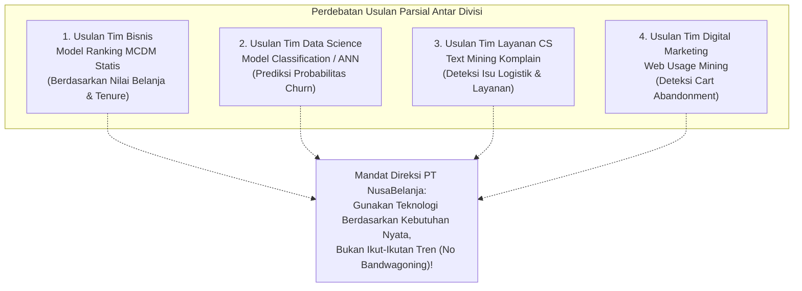
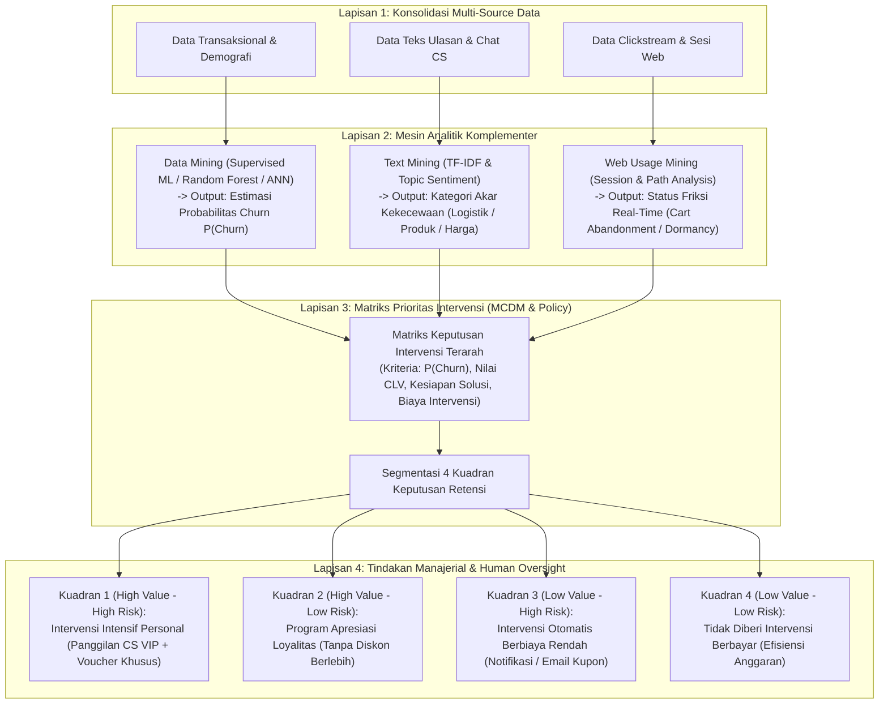

# Analisis Mendalam Kasus PT NusaBelanja: Prioritas Intervensi Pelanggan
*Mata Kuliah Teori Sistem Pendukung Keputusan — Pertemuan 9*

---

> [!abstract] Ringkasan Kasus Diskusi Utama
> **PT NusaBelanja** ingin menentukan pelanggan yang perlu mendapat intervensi retensi. Data yang tersedia meliputi:
> 1. Data Transaksional: histori belanja, frekuensi retur, lama menjadi pelanggan (*tenure*), dan histori pemanfaatan kupon promo.
> 2. Data Historis: label status pelanggan yang telah churn pada periode sebelumnya.
> 3. Data Teks Tidak Terstruktur: puluhan ribu ulasan bintang 1–5 dan catatan tiket komplain Customer Service.
> 4. Data Perilaku Web: berkas jejak klik (*clickstream*) sesi penelusuran situs dan aplikasi.
> 
> **Dilema & Mandat Direksi**:
> Terjadi perdebatan metodologi antar divisi internal (Tim Bisnis ingin MCDM, Tim Data ingin ANN, Tim CS ingin Text Mining, Tim Digital ingin Web Usage Mining). Direksi menegaskan agar **tidak menggunakan teknologi canggih hanya karena teknologi itu tersedia (*no technology bandwagoning*)**. Kelompok dituntut merancang arsitektur pendukung keputusan yang rasional, terintegrasi, hemat biaya, dan benar-benar membantu pengambil keputusan.

---

## 1. Dekonstruksi Usulan Internal Antar Tim

### Evaluasi Kritis terhadap Masing-Masing Usulan:

| Tim Pengusul | Usulan Solusi | Kekuatan Pendekatan | Kelemahan & Titik Kebutaan (*Blind Spot*) |
| :--- | :--- | :--- | :--- |
| **Tim Bisnis** | Ranking pelanggan menggunakan metode kriteria jamak (MCDM) berdasarkan nilai belanja masa lalu (*monetary*) dan lama langganan (*tenure*). | Sederhana, mudah dipahami, tidak membutuhkan komputasi canggih atau data engineer khusus. | **Sangat buta terhadap masa depan.** Pelanggan yang belanja besar di masa lalu bisa saja sedang sangat kecewa bulan ini dan berniat churn besok. Pendekatan ini tidak mampu memprediksi dinamika risiko. |
| **Tim Data Science** | Mengembangkan model klasifikasi atau *Artificial Neural Network (ANN)* untuk memprediksi probabilitas churn dari data historis. | Mampu menemukan pola prediktif non-linear yang akurat dari jutaan kombinasi variabel perilaku transaksi. | **Sifat *Black-Box* dan tanpa konteks kualitatif.** Model hanya menghasilkan angka probabilitas (misal: "Pelanggan X probabilitas churn 84%"), namun tidak mampu menjelaskan *mengapa* dia kecewa dan *tindakan apa* yang harus diambil. Berisiko memicu intervensi salah sasaran (misal memberi voucher diskon pada pelanggan yang sebenarnya kecewa karena barang rusak). |
| **Tim Layanan CS** | Menjalankan *Text Mining* pada puluhan ribu teks tiket komplain dan ulasan bintang 1–3 untuk menyaring isu layanan. | Memberikan wawasan diagnostik kualitatif yang sangat kaya mengenai akar penyebab kekecewaan pelanggan (*root-cause analysis*). | **Tidak memiliki daya jangkau universal.** Hanya sebagian kecil pelanggan yang aktif menulis komplain atau ulasan saat kecewa (fenomena *silent churners*—pelanggan yang langsung pindah ke kompetitor tanpa mengeluh). |
| **Tim Digital Web** | Menerapkan *Web Usage Mining* pada data *clickstream* untuk melacak penurunan frekuensi kunjungan dan pembatalan keranjang. | Mampu mendeteksi penurunan minat secara *real-time* sebelum pelanggan benar-benar berhenti bertransaksi berbulan-bulan. | **Data sangat bising (*noisy*) dan tidak membedakan nilai pelanggan.** Menghabiskan biaya intervensi untuk pengunjung iseng yang bernilai transaksi rendah (*low-value bargain hunters*) akan merugikan keuangan perusahaan. |

---

## 2. Solusi Terpadu: Arsitektur Hibrida Tri-Layer

Untuk menjawab mandat Direksi, kelompok merancang **Arsitektur Tri-Layer Decision Support System** yang menempatkan setiap teknologi pada fungsi alaminya:

---

## 3. Matriks 4 Kuadran Keputusan Intervensi (Decision Policy)

Sistem Pendukung Keputusan tidak membagi anggaran secara rata, melainkan memetakan pelanggan berdasarkan **Tingkat Risiko Churn** (dari Data Mining) dan **Customer Lifetime Value / CLV** (dari Data Transaksi Bisnis):

| Kuadran Keputusan | Karakteristik Pelanggan | Evidence dari Sistem DSS | Rekomendasi Tindakan Manajerial | Alokasi Anggaran |
| :--- | :--- | :--- | :--- | :---: |
| **Kuadran 1: High Value — High Risk** *(Prioritas Kritis / Urgent)* | Pelanggan loyal dengan kontribusi belanja besar, namun terdeteksi berisiko tinggi churn dalam 30 hari ke depan. | - $P(\text{Churn}) > 0.70$. - Text mining mendeteksi keluhan keterlambatan kurir 3x berturut-turut. - Web mining mencatat dwell time anomali pada menu retur. | **Intervensi Personal Tingkat Tinggi (*White-Glove Service*)**: Tim Senior CS menghubungi via telepon, menyelesaikan kendala logistik, dan memberikan kompensasi voucher personal bernilai tinggi. | **55%** dari total anggaran retensi |
| **Kuadran 2: High Value — Low Risk** *(Aset Emas / Pertahankan)* | Pelanggan bernilai belanja tinggi yang aktif dan puas dengan layanan perusahaan. | - $P(\text{Churn}) < 0.20$. - Sentimen ulasan dominan positif (skor sentimen $> +0.75$). - Kunjungan situs rutin mingguan. | **Program Apresiasi Loyalitas Eksklusif**: Pemberian status keanggotaan VIP, akses awal ke produk baru, atau ucapan personal hari raya. Jangan berikan diskon berlebih agar margin tidak tergerus sia-sia. | **15%** dari total anggaran retensi |
| **Kuadran 3: Low Value — High Risk** *(Risiko Massal / Efisiensi)* | Pelanggan pemburu diskon (*bargain hunters*) bernilai transaksi kecil yang terdeteksi akan berhenti berbelanja. | - $P(\text{Churn}) > 0.75$. - Rasio pemakaian promo 95%. - Riwayat *cart abandonment* tinggi di web. | **Intervensi Otomatis Terprogram (*Cost-Effective Automation*)**: Mengirimkan notifikasi aplikasi atau email otomatis berisikan voucher bersyarat belanja minimum. Tanpa melibatkan waktu staf manusia. | **20%** dari total anggaran retensi |
| **Kuadran 4: Low Value — Low Risk** *(Pelanggan Kasual)* | Pelanggan dengan frekuensi dan nilai belanja kecil, namun stabil dan tidak ada indikasi churn mendesak. | - $P(\text{Churn}) < 0.30$. - Tidak ada komplain di CS. | **Tanpa Intervensi Khusus (*Passive Maintenance*)**: Layani dengan standar operasional reguler toko online. Pengeluaran anggaran retensi pada segmen ini dinilai tidak rasional. | **10%** (cadangan promosi reguler) |

---

## 4. Evaluasi Kritis terhadap Risiko dan Keterbatasan (Perspektif D)

Sesuai tuntutan perkuliahan SPK berorientasi *Decision-Centered Structured Discussion (DCSD)*, rancangan ini mengidentifikasi 4 potensi bahaya yang wajib diawasi oleh pengambil keputusan manusia (*Human Oversight*):

1. **Bahaya Miskonsepsi "Semua Problem Harus Menggunakan Deep Learning / ANN"**:
   - Jika hubungan antara variabel transaksi dan churn dapat dijelaskan dengan sangat baik dan akurat menggunakan model *Random Forest* atau *Gradient Boosted Trees (LightGBM/XGBoost)*, maka perusahaan **tidak boleh memaksakan arsitektur ANN multi-layer yang rumit**. Model pohon menawarkan kemudahan audit (*tree splits* transparan) yang jauh lebih dapat diterima oleh tim kepatuhan dan audit operasional perusahaan.
2. **Bahaya "Data Leakage" (Kebocoran Data)**:
   - Pengembang model data mining harus berhati-hati agar tidak menyertakan fitur yang terjadi *setelah* keputusan churn terjadi (misal: "tanggal penutupan akun"). Menyertakan fitur semacam ini akan menghasilkan akurasi palsu 99% pada data uji, namun model akan lumpuh total ketika diterapkan pada data operasional harian nyata.
3. **Bahaya Ambiguitas Bahasa pada Text Mining**:
   - Bahasa konsumen di Indonesia sarat dengan sarkasme (misal: *"Hebat sekali barang baru sampai setelah 3 minggu! Super kilat!"*). Model berbasis *lexicon* sederhana dapat salah menganggap kata "hebat" dan "super kilat" sebagai pujian positif. DSS harus menggunakan modul NLP kontekstual yang dilatih pada domain e-commerce lokal.
4. **Kedaulatan Keputusan Manusia (*Human Judgment as Final Arbiter*)**:
   - Algoritma analitik hanya menyuplai bukti (*evidence*). Otorisasi pemberian potongan harga besar, persetujuan pembatalan pesanan bermasalah, serta audit etika atas data pribadi konsumen tetap berada di tangan manajer manusia (*accountability remains with humans*).

---

> [!check] Navigasi Tautan Obsidian
> - `[[LKD_SPK_Pertemuan_09|Lihat Isian Lembar Kerja LKD-SPK]]`
> - `[[Konsep_Inti_DSS_DataDriven|Catatan Teori 6 Konsep Inti]]`
> - `[[Studi_Kasus_Tiga_Problem_SPK|Tiga Kasus SPK (Ranking, Prediksi, Teks/Web)]]`
> - `[[INDEX_OBSIDIAN|Kembali ke Dashboard Utama]]`
