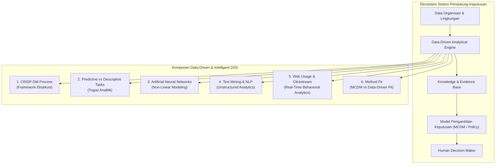
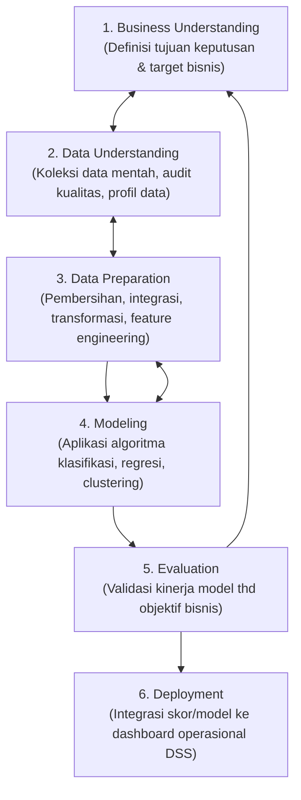
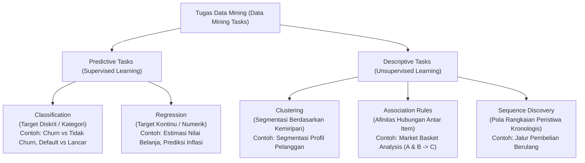
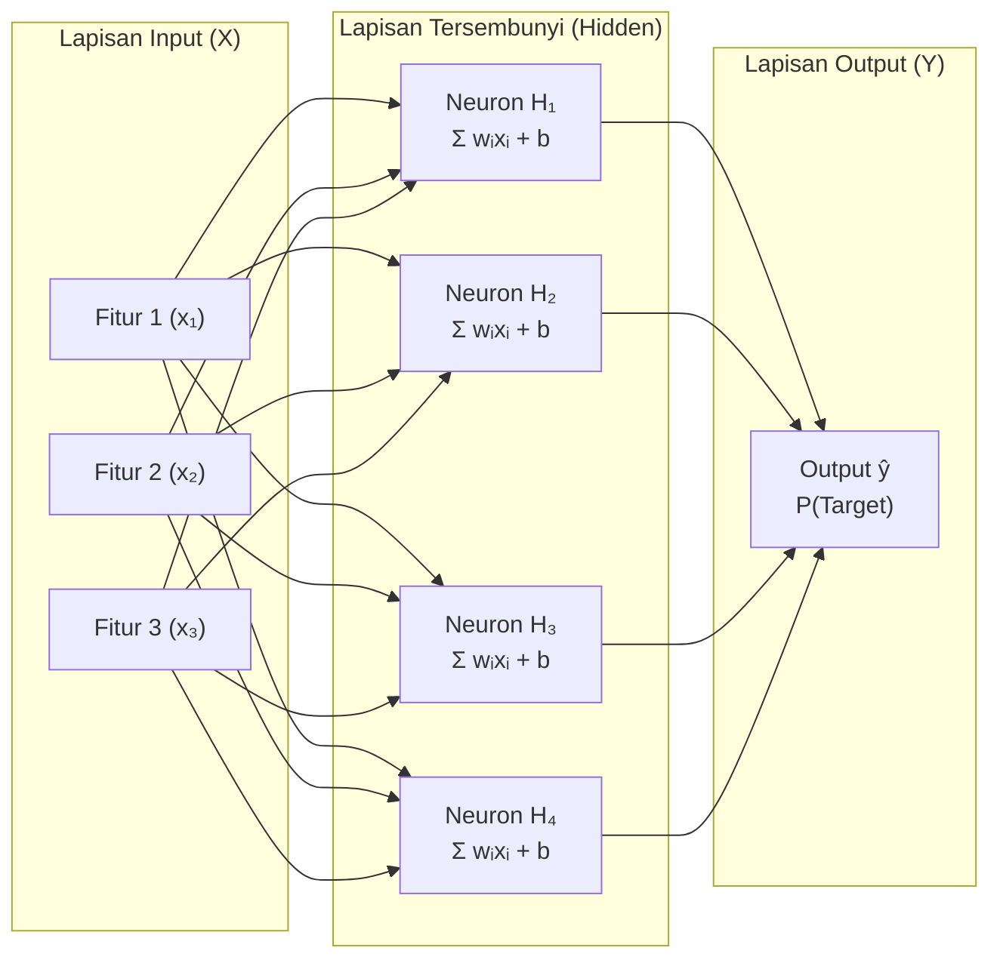
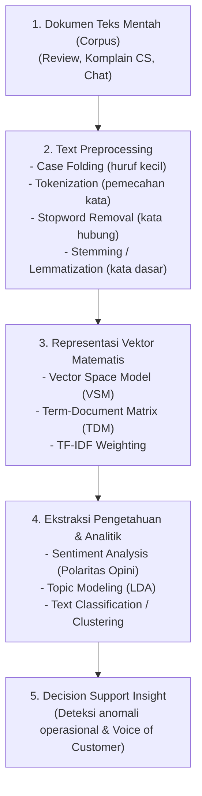
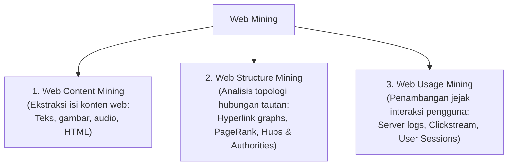
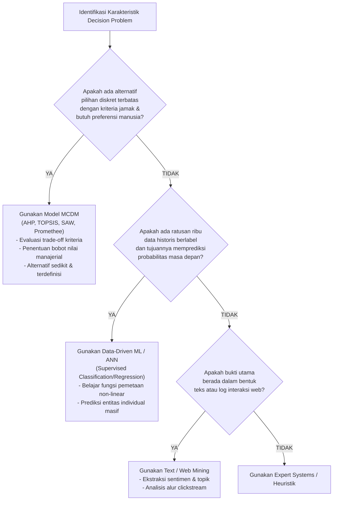

# Konsep Inti: Data-Driven & Intelligent Decision Support
*Kajian Teoretis dan Metodologis Berdasarkan Turban et al. (Bab 5, 6, dan 7) serta Panduan Teori SPK Pertemuan 9*

---

> [!abstract] Ikhtisar Dokumen
> Catatan ini menyajikan penjelasan komprehensif, ringkas, terstruktur, dan mendalam mengenai 6 konsep fundamental dalam pengembangan **Data-Driven & Intelligent Decision Support Systems (DSS)**. Dokumen ini dirancang khusus untuk memenuhi standar akademik mata kuliah Teori SPK (Semester 5 FT UNY) serta terintegrasi langsung dengan format lembar kerja pada `[[LKD_SPK_Pertemuan_09|LKD SPK Pertemuan 09]]`.

---

## 1. Proses Data Mining: Siklus Standar CRISP-DM
*(Turban Bab 5, Hal. 5-10 s.d. 5-16)*

### 1.1 Definisi & Latar Belakang
**Data Mining** didefinisikan oleh Turban et al. sebagai proses non-trivial untuk mengidentifikasi pola-pola yang valid, baru, berpotensi berguna, dan pada akhirnya dapat dipahami dari repositori data yang masif. Dalam konteks DSS, data mining tidak berdiri sendiri sebagai rutinitas matematika, melainkan diikat oleh metodologi standar industri yaitu **CRISP-DM (Cross-Industry Standard Process for Data Mining)**.

### 1.2 Enam Fase Terstruktur CRISP-DM

1. **Business Understanding (Pemahaman Bisnis)**:
   - Merumuskan sasaran keputusan dari sudut pandang manajerial, bukan sekadar sudut pandang statistik.
   - Mengubah masalah manajerial (misal: "Mengapa laba divisi retail turun?") menjadi formulasi data mining (misal: "Prediksi probabilitas churn pelanggan bernilai tinggi").
2. **Data Understanding (Pemahaman Data)**:
   - Mengumpulkan data mentah, mengidentifikasi kualitas data (*missing values*, outlier, duplikasi, inkonsistensi).
   - Melakukan *Exploratory Data Analysis (EDA)* untuk memahami korelasi awal variabel prediktor dengan target.
3. **Data Preparation (Persiapan Data)**:
   - Tahap paling memakan waktu (60%–80% sumber daya proyek).
   - Mencakup penanganan *null values*, rekayasa fitur (*feature engineering* seperti rasio RFM), transformasi distribusi data, normalisasi (min-max atau standardisasi z-score), dan penyeimbangan kelas (*class imbalance handling* via SMOTE atau undersampling).
4. **Modeling (Pemodelan)**:
   - Memilih dan menerapkan teknik pemodelan yang sesuai (misal: Decision Tree, Logistic Regression, Random Forest, ANN, atau K-Means).
   - Menyetel hiperparameter (*hyperparameter tuning*) dan membagi dataset ke dalam data latih (*training*), validasi (*validation*), dan uji (*test set*).
5. **Evaluation (Evaluasi)**:
   - Menguji apakah model benar-benar memenuhi kriteria keputusan bisnis, bukan hanya metrik matematika semu.
   - Mengaudit potensi **Data Leakage** (kebocoran informasi masa depan ke masa lalu) dan mengevaluasi kurva biaya riil (*cost-benefit matrix*).
6. **Deployment (Penerapan)**:
   - Mengintegrasikan hasil model ke dalam alur pengambilan keputusan nyata (misal: menghubungkan output API skor risiko ke dashboard CRM atau sistem kasir POS).
   - Menyusun prosedur audit, pemeliharaan (*maintenance*), dan pemantauan pergeseran data (*data drift*).

### 1.3 Hubungan dengan DSS dan Pengambilan Keputusan
> [!important] Implikasi untuk DSS
> CRISP-DM adalah "jembatan keselamatan" yang memastikan sistem analitik tidak terisolasi di laboratorium komputasi. Tanpa kepatuhan pada fase 1 (*Business Understanding*) dan fase 5 (*Evaluation*), sebuah DSS akan menderita sindrom *technological illusion*—yaitu menghasilkan model dengan akurasi 95% di atas kertas, namun sama sekali tidak dapat dieksekusi atau tidak berdampak nyata pada keputusan manajerial.

---

## 2. Taksonomi Tugas Analitik: Predictive vs. Descriptive Tasks
*(Turban Bab 5, Hal. 5-6 s.d. 5-26)*

### 2.1 Perbandingan Karakteristik Tugas Analitik

| Dimensi Perbandingan | Predictive Tasks (Supervised) | Descriptive Tasks (Unsupervised) |
| :--- | :--- | :--- |
| **Ketersediaan Target Label** | Wajib memiliki variabel target yang telah berlabel pada data historis ($y$). | Tidak memiliki variabel target ($y$ tidak ada); algoritma mencari pola laten sendiri ($X$). |
| **Tujuan Analitik** | Memproyeksikan perilaku atau nilai masa depan dari entitas baru. | Memetakan struktur internal, karakteristik alami, atau afinitas data yang ada. |
| **Metode / Algoritma Utama** | - Klasifikasi: *Decision Trees (C4.5, CART), Logistic Regression, Naive Bayes, ANN, SVM, Random Forest*. - Regresi: *Linear Regression, Ridge/Lasso, Support Vector Regression*. | - Clustering: *K-Means, Hierarchical Clustering, DBSCAN*. - Association: *Apriori, FP-Growth*. - Sequence: *PrefixSpan, GSP*. |
| **Metrik Evaluasi** | Confusion Matrix, Accuracy, Precision, Recall, F1-Score, ROC-AUC, Mean Squared Error (MSE), RMSE. | Silhouette Coefficient, Davies-Bouldin Index, Support, Confidence, Lift. |
| **Bentuk Output ke DSS** | Skor probabilitas individu, estimasi nilai masa depan, atau label kelas risiko. | Kelompok segmen (cluster centroids), aturan implikasi ($A \rightarrow B$), dan peta topologi hubungan. |

### 2.2 Hubungan dengan DSS dan Pengambilan Keputusan
- **Dukungan dari Predictive Tasks**: Berfungsi sebagai *radar peringatan dini (early warning system)* dan *probabilistic evidence*. Membantu manajer membuat keputusan taktis/operasional tingkat mikro per entitas (misal: "Beri nasabah ID-8829 batas kredit maksimal Rp 10 juta karena probabilitas gagal bayarnya hanya 3%").
- **Dukungan dari Descriptive Tasks**: Berfungsi sebagai *peta pemahaman strategis*. Membantu manajer merumuskan kebijakan makro, perancangan paket produk (*bundling*), tata letak rak toko (*shelf layout*), atau strategi pemasaran berbasis segmen demografi/perilaku.

---

## 3. Artificial Neural Networks (ANN) & Keterbatasan "Black Box"
*(Turban Bab 6, Hal. 6-2 s.d. 6-25)*

### 3.1 Arsitektur & Prinsip Komputasi
**Artificial Neural Network (ANN)** atau Jaringan Saraf Tiruan adalah model pemrosesan informasi non-linier terdistribusi yang terinspirasi oleh sistem saraf biologis mamalia. Struktur paling dominan dalam bisnis adalah **Multilayer Perceptron (MLP)** dengan arsitektur tiga lapisan:

- **Mekanisme Kerja**:
  1. *Forward Propagation*: Input fitur dikalikan bobot interkoneksi ($w_{ij}$), dijumlahkan bersama nilai bias ($b$), lalu dilewatkan ke fungsi aktivasi non-linier (seperti Sigmoid, ReLU, atau Tanh) untuk menghasilkan prediksi $\hat{y}$.
  2. *Error Calculation*: Menghitung selisih antara prediksi model ($\hat{y}$) dengan label historis aktual ($y$) menggunakan fungsi kerugian (*Loss Function*, misal *Binary Cross-Entropy*).
  3. *Backpropagation*: Menghitung gradien kesalahan terhadap setiap bobot menggunakan aturan rantai (*chain rule* kalkulus) dan memperbarui bobot secara berulang menggunakan algoritma optimasi (seperti *Gradient Descent* atau *Adam*) menuju kesalahan minimum.

### 3.2 Fenomena "Black Box" dan Dilema DSS

> [!warning] Miskonsepsi Kritis: "ANN Selalu Lebih Baik Karena Lebih Canggih"
> Turban et al. secara eksplisit memperingatkan bahwa ANN memiliki kelemahan mendasar dalam sistem pendukung keputusan: **ketiadaan transparansi (opaque nature / black-box problem)**.
> - Pada model *Decision Tree*, penalarannya bersifat transparan (*white-box*): *"JIKA Penghasilan < 5 juta DAN Riwayat Keterlambatan > 3 kali MAKA Tolak Kredit"*.
> - Pada model *ANN*, keputusan dihasilkan dari kombinasi ratusan ribu perkalian matriks numerik dan bobot non-linier pada *hidden layers* yang mustahil dibaca secara langsung oleh manusia.

### 3.3 Mitigasi Black Box dalam Pengambilan Keputusan
Untuk mempertahankan akuntabilitas manajerial, pengembang DSS wajib menerapkan:
1. **Sensitivity Analysis (Analisis Sensitivitas)**: Menguji seberapa besar fluktuasi output prediksi jika salah satu variabel input divariasikan sementara variabel lain dibuat konstan.
2. **Explainable AI (XAI - SHAP / LIME)**: Menghitung kontribusi marjinal masing-masing fitur terhadap skor probabilitas individu tertentu (*local feature importance*).
3. **Human-in-the-Loop Safeguard**: Menjadikan output ANN semata-mata sebagai skor bukti pendukung (*evidence indicator*), sedangkan otorisasi akhir untuk penolakan hak konsumen atau tindakan hukum tetap wajib ditandatangani oleh *human decision maker*.

---

## 4. Text Mining & Pemrosesan Data Teks Tidak Terstruktur
*(Turban Bab 7, Hal. 7-2 s.d. 7-20)*

### 4.1 Definisi & Tantangan Data Bahasa Alami
**Text Mining** adalah penerapan konsep data mining pada kumpulan data dokumen tekstual semi/tidak terstruktur. Dokumen teks tidak tersusun rapi dalam kolom dan baris basis data relasional, melainkan sarat dengan ambiguitas semantik, sinonim, homonim, slang (*bahasa gaul*), tata bahasa informal, dan sarkasme.

### 4.2 Alur Pemrosesan Teks Menuju Format Terstruktur

- **Term-Document Matrix (TDM)**: Sebuah matriks di mana baris merepresentasikan istilah/kata unik (*terms*), dan kolom merepresentasikan dokumen ulasan/komplain (*documents*). Nilai sel ($w_{i,j}$) diisi menggunakan pembobotan **TF-IDF (Term Frequency-Inverse Document Frequency)**:
  $$\text{TF-IDF}(t, d, D) = \text{TF}(t, d) \times \log\left(\frac{|D|}{|\{d \in D : t \in d\}|}\right)$$
  Formula ini memberikan bobot tinggi pada istilah yang sering muncul dalam suatu keluhan spesifik, namun memberikan penalti pada kata umum yang muncul di seluruh dokumen bisnis.

### 4.3 Analisis Sentimen (Opinion Mining)
Mengklasifikasikan orientasi opini teks ke dalam kategori polaritas (*Positif*, *Netral*, *Negatif*) atau skala skor intensitas kepuasan [-1.0 s.d. +1.0]. Analisis ini dapat dilakukan berbasis kamus istilah (*lexicon-based*) maupun pembelajaran mesin (*machine learning classifier*).

### 4.4 Hubungan dengan DSS dan Pengambilan Keputusan
Text mining melengkapi keterbatasan data transaksional kuantitatif. Data transaksi hanya memberi tahu manajer **apa yang terjadi** (*what happened*, misal: penjualan produk X turun 20%), sedangkan text mining memberi tahu manajer **mengapa hal itu terjadi** (*why it happened*, misal: 80% ulasan negatif mengeluhkan bahan mudah sobek dan resleting rusak).

---

## 5. Web Mining: Triad Penambangan & Clickstream Analysis
*(Turban Bab 7, Hal. 7-25 s.d. 7-38)*

### 5.1 Taksonomi Tiga Pilar Web Mining
Turban et al. mengklasifikasikan penambangan web ke dalam tiga cabang yang berbeda secara ontologis:

1. **Web Content Mining**: Menambang informasi dan pengetahuan langsung dari isi halaman web (artikel, deskripsi produk e-commerce, konten dokumen web).
2. **Web Structure Mining**: Menambang pola tautan antar-halaman (*hyperlinks*). Algoritma terkenalnya mencakup **Google PageRank** dan **Kleinberg's HITS** untuk mengukur otoritas serta popularitas suatu simpul web dalam jaringan informasi.
3. **Web Usage Mining**: Menambang data aktivitas pengunjung web yang terekam otomatis dalam berkas log server web (*web server logs*), kuki (*cookies*), dan aplikasi seluler.

### 5.2 Anatomi Analisis Clickstream (Web Usage Mining)
Analisis *clickstream* merekonstruksi seluruh lintasan navigasi pengguna (*user navigation path*) selama satu sesi interaksi:
- **Sessionization**: Mengelompokkan klik-klik individual ke dalam satu sesi interaksi utuh pengguna.
- **Path Analysis**: Memetakan rute navigasi paling umum yang dilalui calon pembeli dari halaman beranda hingga konfirmasi pembayaran.
- **Funnel Conversion & Abandonment Analysis**: Mengidentifikasi titik kritis di mana pengunjung meninggalkan situs (*drop-off*), khususnya fenomena *shopping cart abandonment* di mana calon pelanggan memasukkan barang ke keranjang namun membatalkan transaksi pada tahap checkout.

### 5.3 Hubungan dengan DSS dan Pengambilan Keputusan
Web Usage Mining memberikan bukti perilaku dalam hitungan detik (*real-time behavioral evidence*). Pada DSS modern, sistem pendukung keputusan tidak perlu menunggu hingga pelanggan mengirim komplain atau berhenti bertransaksi berbulan-bulan. Ketika pola *clickstream* mendeteksi bahwa pengguna mengalami keraguan (misal: membuka dan menutup dropdown metode pembayaran 5 kali dalam 2 menit), DSS dapat langsung menginstruksikan sistem untuk memicu tindakan intervensi real-time (seperti menawarkan panduan live-chat atau diskon ongkir instan).

---

## 6. Method Fit: MCDM (Ranking Alternatif) vs. Data-Driven Machine Learning
*(Panduan Mahasiswa Teori SPK Pertemuan 9, Hal. 2; Turban Bab 5–7)*

### 6.1 Fondasi Filosofis dan Perbedaan Metodologis
Salah satu kompetensi utama yang dituntut dalam perkuliahan SPK Pertemuan 9 adalah kemampuan menganalisis **Method Fit (Kesesuaian Metode)**. Tidak semua masalah keputusan harus diselesaikan dengan Machine Learning, dan tidak semua masalah cukup diselesaikan dengan perankingan kriteria sederhana.

### 6.2 Matriks Perbandingan Komparatif: MCDM vs. Data-Driven ML

| Atribut Evaluasi | Multi-Criteria Decision Making (MCDM) | Data-Driven Machine Learning (ML / ANN) |
| :--- | :--- | :--- |
| **Bahan Input Utama** | Matriks keputusan: sekumpulan alternatif diskret ($m$) dievaluasi terhadap kriteria jamak ($n$), disertai bobot preferensi ($w$). | Matriks data historis: ratusan ribu baris catatan kejadian masa lalu ($X$) dengan variabel target ($y$). |
| **Karakter Masalah** | *Evaluation & Prioritization*: Memilih alternatif terbaik atau meranking alternatif terbatas yang saling bersaing. | *Pattern Recognition & Generalization*: Menemukan fungsi matematis tersembunyi untuk memprediksi kejadian baru. |
| **Peran Manusia** | **Sangat dominan di awal**: Menentukan kriteria, menilai kepentingan relatif kriteria, dan memberikan skor pertimbangan (*pairwise comparison*). | **Dominan di evaluasi**: Mengawasi kualitas data, menetapkan ambang batas (*threshold*), dan menyusun kebijakan intervensi. |
| **Kelebihan Utama** | Mampu menangani kriteria kualitatif abstrak, sangat transparan secara manajerial, tidak memerlukan data historis besar. | Beradaptasi secara dinamis dengan volume data raksasa, mampu menangani pola non-linear rumit, akurasi prediksi tinggi. |
| **Kelemahan Utama** | Rentan bias subjektivitas pengambil keputusan; tidak mampu memproses jutaan data individual secara dinamis. | Memerlukan data historis besar dan bersih; rentan *black-box*, *overfitting*, serta tidak memahami konteks etika bisnis. |
| **Contoh Kasus Ideal** | - Pemilihan vendor logistik terbaik. - Penentuan lokasi ekspansi gudang baru. - Seleksi penerima beasiswa unggulan. | - Prediksi probabilitas gagal bayar kartu kredit. - Prediksi pembatalan layanan (*customer churn*). - Deteksi anomali transaksi pencucian uang. |

### 6.3 Sinergi Arsitektur Hibrida (Hybrid Decision Support Systems)
Dalam sistem pendukung keputusan modern kelas enterprise, kedua metode ini tidak dipertentangkan, melainkan **disinergikan secara berjenjang (pipelining)**:
1. **Tahap 1 (Data-Driven ML)**: Model klasifikasi memproses ratusan ribu data historis untuk menghasilkan probabilitas risiko objektif ($P_{\text{churn}}$ atau $P_{\text{default}}$).
2. **Tahap 2 (Text & Web Mining)**: Menyaring akar penyebab ketidakpuasan dari ulasan teks dan mendeteksi anomali perilaku web.
3. **Tahap 3 (MCDM Prioritization)**: Probabilitas risiko dari ML dan skor sentimen dari Text Mining diperlakukan sebagai **kriteria kuantitatif** baru, yang digabungkan bersama kriteria bisnis lain (seperti *Customer Lifetime Value*, biaya intervensi, kapasitas staf operasional) untuk merangking prioritas tindakan manajerial akhir.

---

> [!check] Navigasi Tautan Obsidian
> - Melanjutkan ke LKD Diskusi: `[[LKD_SPK_Pertemuan_09|Kembali ke Lembar Kerja LKD-SPK]]`
> - Memeriksa 3 Kasus Keputusan Nyata: `[[Studi_Kasus_Tiga_Problem_SPK|Lihat Tiga Contoh Problem SPK (Ranking, Prediksi, Teks/Web)]]`
> - Memeriksa Penerapan pada Studi Kasus PT NusaBelanja: `[[Kasus_PT_NusaBelanja_Analisis|Analisis Kasus PT NusaBelanja]]`
