# LEMBAR KERJA DISKUSI SISTEM PENDUKUNG KEPUTUSAN
**FAKULTAS TEKNIK — UNIVERSITAS NEGERI YOGYAKARTA**  
*Mata Kuliah: Teori Sistem Pendukung Keputusan (Semester 5)*  
*Model Pembelajaran: Decision-Centered Structured Discussion (DCSD)*  
*Dokumen Referensi:* `[[INDEX_OBSIDIAN|Navigasi Berkas Obsidian]]` | `[[Konsep_Inti_DSS_DataDriven|Catatan Konsep Inti]]` | `[[Studi_Kasus_Tiga_Problem_SPK|Tiga Contoh Problem SPK]]` | `[[Kasus_PT_NusaBelanja_Analisis|Analisis Kasus PT NusaBelanja]]`

---

> [!abstract] Petunjuk Penggunaan Template
> Gunakan template ini sebagai lembar kerja resmi diskusi kelompok. Sesuai Panduan Teori Pertemuan 9, **Bagian B** diisi mandiri sebelum kelas berdasarkan hasil membaca bahan bacaan Turban Bab 5–7. **Bagian C** dan **E** mengkaji Kasus Utama *Prioritas Intervensi Pelanggan PT NusaBelanja*. **Bagian D, F, dan G** memuat sintesis analisis inti, pendalaman perspektif, serta rekomendasi keputusan akhir kelompok.

---

## A. Identitas Pertemuan dan Kelompok

### Tabel 1: Identitas Perkuliahan
| Pertemuan | Topik / Bab | Kelas | Kelompok | Perspektif Diskusi |
| :---: | :--- | :---: | :---: | :---: |
| **9** | **Data-Driven & Intelligent Decision Support: Data Mining, Artificial Neural Networks (ANN), Text & Web Mining (Turban Bab 5–7)** | **A / B / F** *(Sesuaikan)* | **Kelompok [X]** | **Perspektif A - Concept & Theory** |

> [!info] Panduan Pemilihan Perspektif (Berdasarkan Panduan Teori Pertemuan 9)
> - **Perspektif A (Concept & Theory)**: Membedakan MCDM, data mining, ANN, text mining, dan web mining sebagai bentuk dukungan keputusan yang berbeda.
> - **Perspektif B (Case & Implementation)**: Menentukan pendekatan paling tepat pada kasus dan bagaimana output dipakai oleh *decision maker*.
> - **Perspektif C (Method & Technology)**: Memetakan alur *data -> preparation/representation -> task/model -> evaluation -> output -> human decision*.
> - **Perspektif D (Critical Evaluation)**: Menguji kualitas data, validitas target, *data leakage*, *overfitting*, sifat *black-box*, ambiguitas teks, bias, dan risiko otomatisasi.
> - **Perspektif BC (Case, Method & Implementation)**: Khusus kelas 3 kelompok; menggabungkan kelayakan teknologi dengan alur metode implementasi dari masalah hingga aksi keputusan.

### Tabel 2: Tim Penyusun LKD
| Peran | Nama Mahasiswa | NIM | Catatan Kontribusi |
| :--- | :--- | :---: | :--- |
| **Presenter** | *[Nama Mahasiswa]* | *[NIM]* | Bertanggung jawab memimpin pemaparan hasil analisis kelompok |
| **Notulis** | *[Nama Mahasiswa]* | *[NIM]* | Bertanggung jawab mencatat dinamika argumentasi dan klarifikasi |
| **Anggota Kelompok** | 1. *[Nama Mahasiswa 1]* 2. *[Nama Mahasiswa 2]* 3. *[Nama Mahasiswa 3]* 4. *[Nama Mahasiswa 4]* | *[NIM]* *[NIM]* *[NIM]* *[NIM]* | Analisis konsep, pemodelan kasus, dan penyusunan rekomendasi |

---

## B. Kesiapan dan Pemahaman Awal

Tuliskan minimal tiga konsep utama dari bahan bacaan/pertemuan.

| Konsep Utama                                                       | Definisi Singkat                                                                                                                                                                                                                                                                                                       | Hubungan dengan DSS/Keputusan                                                                                                                                                                                                                                                                                                                      |
| :----------------------------------------------------------------- | :--------------------------------------------------------------------------------------------------------------------------------------------------------------------------------------------------------------------------------------------------------------------------------------------------------------------- | :------------------------------------------------------------------------------------------------------------------------------------------------------------------------------------------------------------------------------------------------------------------------------------------------------------------------------------------------- |
| **CRISP-DM (Cross-Industry Standard Process for Data Mining)**     | Metodologi berulang terstandar yang terdiri atas enam fase sistematis: *Business Understanding*, *Data Understanding*, *Data Preparation*, *Modeling*, *Evaluation*, dan *Deployment* untuk memandu proyek penambangan data dari perumusan masalah hingga penerapan solusi.                                            | Menjamin bahwa pengembangan DSS berbasis analitik tidak berhenti sebagai eksperimen algoritma semata, melainkan berakar pada kebutuhan keputusan manajerial nyata (*fase 1*) dan output akhirnya diintegrasikan ke alur kerja operasional organisasi (*fase 6*).                                                                                   |
| **Predictive Modeling vs. Descriptive Modeling**                   | Dua taksonomi utama tugas penambangan data: *predictive* memproyeksikan nilai variabel target masa depan dari data berlabel masa lalu (klasifikasi/regresi), sedangkan *descriptive* mengeksplorasi struktur laten, kemiripan kelompok (*clustering*), atau asosiasi tanpa adanya variabel target awal.                | Menentukan bentuk dukungan keputusan yang tepat: tugas *predictive* menyuplai estimasi probabilitas dan peringatan dini (*early warning*) untuk intervensi entitas individual, sedangkan tugas *descriptive* memberikan pemetaan pola intrinsik untuk perumusan kebijakan strategis makro.                                                         |
| **Backpropagation & Sifat Black-Box (Artificial Neural Networks)** | Algoritma pembelajaran pada jaringan saraf tiruan yang menghitung gradien kesalahan secara mundur untuk menyesuaikan bobot antar-neuron, yang menghasilkan daya pemodelan non-linear berakurasi tinggi namun mekanismenya tidak transparan (*black-box*) karena alur logikanya tidak dapat diinspeksi secara langsung. | Menyadarkan pengambil keputusan bahwa output model cerdas berfungsi sebagai bahan bukti pendukung (*evidence/probability*), bukan keputusan mutlak. Hal ini menuntut adanya pengawasan manusia (*human oversight*) dan analisis sensitivitas (*explainability*) agar keputusan akhir tetap dapat dipertanggungjawabkan secara etis dan manajerial. |
| **Term-Document Matrix (TDM) & TF-IDF Weighting**                  | Representasi matematis dalam penambangan teks yang mengonversi korpus dokumen tidak terstruktur menjadi matriks frekuensi istilah (*terms*) terhadap dokumen, di mana bobot *TF-IDF* mengukur tingkat kepentingan relatif suatu kata unik di dalam dokumen terhadap seluruh korpus teks.                               | Berperan sebagai jembatan transformasi data kualitatif tidak terstruktur (ulasan, catatan komplain, atau umpan balik tertulis) menjadi input kuantitatif terstruktur pada DSS. Hal ini memungkinkan sistem mengungkap alasan mendasar dan sentimen kualitatif (*Voice of Customer/Stakeholder*) yang melatarbelakangi suatu fenomena keputusan.    |
| **Clickstream Analysis & Web Usage Mining**                        | Teknik analitik yang mengekstrak dan memodelkan data jejak aktivitas navigasi pengguna web dari berkas log server, meliputi penelusuran rute halaman (*path analysis*), durasi sesi (*dwell time*), pola pencarian kata kunci, serta titik penghentian transaksi (*abandonment*).                                      | Menyediakan bukti perilaku pengguna secara *real-time* sebelum sebuah transaksi atau keputusan terjadi. Bukti ini memungkinkan DSS memicu rekomendasi atau intervensi proaktif seketika bagi manajemen untuk merespons kebutuhan dan mengatasi hambatan pengguna di platform digital.                                                              |

 

| Catatan awal kelompok | Hal yang masih perlu diklarifikasi saat diskusi |
| :--- | :--- |
| 1. **Peran Komplementer Data-Driven dalam DSS**: Teknologi penambangan data, ANN, serta Text/Web Mining bertindak sebagai mesin analitik penyedia bukti empiris (*evidence*) untuk memperkuat pertimbangan pengambil keputusan, bukan untuk menggantikan peran pertimbangan (*judgment*) manusia.  2. **Prediksi Bukan Keputusan Akhir (*Prediction $\neq$ Decision*)**: Akurasi teknis model yang tinggi tidak otomatis menghasilkan keputusan yang efektif jika target prediksinya keliru atau hasil analisisnya tidak dapat ditindaklanjuti secara nyata (*actionability*). Tindakan tetap memerlukan kebijakan organisasi dan kaji dampak risiko.  3. **Prinsip Kesesuaian Metode (*Method Fit*)**: Model perankingan multi-kriteria (MCDM) dan model pembelajaran data historis (Machine Learning) memiliki fungsi yang berbeda. MCDM tepat digunakan ketika keputusan melibatkan alternatif terbatas dan pembobotan nilai subjektif manusia, sedangkan Machine Learning tepat digunakan ketika terdapat data historis besar untuk memproyeksikan pola probabilitas masa depan. | 1. **Batas Toleransi Model Black-Box**: Kapan organisasi harus memilih model transparan (*white-box*) seperti Pohon Keputusan (*Decision Tree*) meskipun akurasinya sedikit lebih rendah, dibandingkan model *black-box* seperti ANN pada keputusan yang berimplikasi hukum, etika, atau risiko finansial tinggi (*high-stakes decisions*)?  2. **Fusi Bukti Multimodal**: Bagaimana metode terbaik dalam DSS untuk menggabungkan skor sentimen dari data teks tidak terstruktur dengan skor probabilitas data numerik terstruktur tanpa menimbulkan distorsi atau pembobotan ganda (*collinearity*)?  3. **Penentuan Ambang Batas Intervensi (*Threshold Optimization*)**: Bagaimana cara menentukan batas probabilitas (*cut-off*) yang paling optimal agar biaya intervensi seimbang dengan risiko kerugian akibat kesalahan klasifikasi (*False Positives* vs *False Negatives*)?  4. **Penanganan Masalah Data Awal Terbatas (*Cold-Start Problem*)**: Bagaimana sistem pendukung keputusan memberikan rekomendasi yang andal ketika entitas baru belum memiliki riwayat transaksi maupun jejak interaksi web? |

---

## C. Kasus / Isu / Decision Problem

### Ringkasan Kasus Diskusi Utama: Prioritas Intervensi Pelanggan PT NusaBelanja
*(Sumber: Panduan Mahasiswa Teori SPK Pertemuan 9, Halaman 3)*

> [!quote] Narasi Kasus
> **PT NusaBelanja** (perusahaan e-commerce retail nasional) menghadapi peningkatan tingkat kehilangan pelanggan (*customer churn*). Manajemen ingin merumuskan strategi **intervensi retensi yang tepat sasaran** agar anggaran retensi tidak terbuang sia-sia pada pelanggan yang salah.
> 
> **Aset Data yang Tersedia:**
> - Data Transaksional Terstruktur: Riwayat transaksi belanja, nilai belanja (monetary), frekuensi retur produk, lama menjadi pelanggan (*tenure*), dan histori pemanfaatan kupon promo.
> - Data Historis Label: Rekam jejak pelanggan yang sudah benar-benar churn pada periode sebelumnya.
> - Data Teks Tidak Terstruktur: Puluhan ribu teks ulasan produk bintang 1–5 dan catatan riwayat komplain ke tim Customer Service.
> - Data Perilaku Web: Data *clickstream* interaksi penelusuran situs web dan aplikasi seluler (riwayat pencarian, waktu menetap, halaman keranjang).
> 
> **Perdebatan Antar Tim Internal:**
> 1. **Tim Bisnis**: Mengusulkan pendekatan sederhana dengan meranking seluruh pelanggan menggunakan metode kriteria jamak (MCDM) berdasarkan nilai belanja dan masa berlangganan.
> 2. **Tim Data Science**: Mengusulkan penggunaan model *Classification* atau *Artificial Neural Network (ANN)* untuk memprediksi probabilitas *churn* tiap pelanggan dari data historis.
> 3. **Tim Layanan Pelanggan (CS)**: Mendesak penggunaan *Text Mining* untuk menyaring topik komplain dan mendeteksi pelanggan yang mengalami kekecewaan berat terhadap layanan pengiriman.
> 4. **Tim Digital / Web Marketing**: Mengusulkan *Web Usage Mining* untuk mendeteksi penurunan drastis frekuensi kunjungan dan pengabaian keranjang belanja (*cart abandonment*).
> 
> **Mandat Direksi PT NusaBelanja:**
> Direksi secara tegas meminta agar tim **tidak menggunakan teknologi canggih hanya karena teknologi itu tersedia (*no technology bandwagoning*)**. Kelompok dituntut mendesain sebuah sistem pendukung keputusan terpadu yang memetakan fungsi masing-masing teknologi secara rasional, menentukan kombinasi yang masuk akal, dan menghasilkan rekomendasi yang benar-benar membantu pengambil keputusan melakukan intervensi yang efektif dan hemat biaya.

---

## D. Analisis Inti DSS — Wajib untuk Semua Kelompok

```mermaid
flowchart LR
    A["Problem: Peningkatan Churn & Inefisiensi Anggaran Retensi"] --> B["Decision Maker: Direktur Komersial & Tim Retensi CRM"]
    B --> C["Data: Transaksi, Label Historis Churn, Teks Komplain, Clickstream"]
    C --> D["Model: Arsitektur Hibrida (Data Mining + Text/Web Mining + MCDM Scoring)"]
    D --> E["Alternatives: 4 Opsi Strategi Intervensi"]
    E --> F["Analysis/Output: Segmen Risiko, Probabilitas Churn, Root-Cause Teks"]
    F --> G["Recommendation: Aksi Retensi Berjenjang Sesuai Skala CLV vs Risiko"]
    G --> H["Human Decision: Pengesahan Anggaran, SOP Pengecualian, & Review Etis"]
```

### Tabel 7: Benang Merah 12 Elemen Inti DSS (Kasus PT NusaBelanja)

| Elemen Inti DSS | Hasil Analisis Kelompok |
| :--- | :--- |
| **1. Problem / Opportunity** | Tingginya rasio pelanggan yang berhenti bertransaksi (*churn*) dan inefisiensi pengeluaran anggaran retensi akibat intervensi massal yang salah sasaran, serta adanya perpecahan pendekatan analitik antar divisi internal. Peluang: Membangun sistem pendukung keputusan retensi terpadu berbasis *multi-source evidence*. |
| **2. Decision Maker / Problem Owner** | Direktur Komersial (*Chief Commercial Officer*) dan Kepala Divisi *Customer Relationship Management (CRM) & Retention*. |
| **3. Stakeholders** | Tim Pemasaran (eksekutor kampanye promo), Tim Layanan Pelanggan/CS (penangan eskalasi komplain), Tim Operasional & Logistik (penanggung jawab kualitas retur & pengiriman), serta Pelanggan PT NusaBelanja. |
| **4. Objective / Tujuan Keputusan** | Menurunkan tingkat *churn rate* sebesar minimal 15% pada kuartal mendatang dan meningkatkan ROI (*Return on Investment*) anggaran promosi retensi sebesar minimal 25% melalui intervensi yang terpersonalisasi, tepat sasaran, dan tepat waktu. |
| **5. Data / Information / Knowledge** | - **Data Transaksional**: Recency, Frequency, Monetary (RFM), rasio retur barang, rasio pemakaian promo, tenor. - **Data Historis**: Label biner status churn 12 bulan lalu. - **Data Teks**: Teks tiket aduan CS dan ulasan ulasan negatif pada web. - **Data Web / Clickstream**: Tren penurunan kunjungan mingguan, frekuensi *cart abandonment*. - **Knowledge Domain**: Batasan biaya intervensi per pelanggan dan ambang batas toleransi ketidakpuasan layanan. |
| **6. Model / Method / Analysis** | **Pendekatan Hibrida Tiga Lapisan (Tri-Layer Hybrid Architecture):** 1. *Layer 1 (Predictive Analytics)*: Model klasifikasi (Gradient Boosting / Random Forest atau ANN terkalibrasi) untuk menghitung estimasi probabilitas churn individual $P(Churn)$. 2. *Layer 2 (Diagnostic & Behavioral Analytics)*: *Text Mining* (analisis sentimen & ekstraksi topik keluhan) untuk mendiagnosis penyebab ketidakpuasan, dipadukan dengan *Web Usage Mining* (deteksi friksi navigasi/checkout). 3. *Layer 3 (Decision Prioritization - MCDM)*: Perankingan prioritas intervensi menggunakan matriks 2D (Probabilitas Churn $\times$ *Customer Lifetime Value*) dengan pembobotan preferensi manajerial. |
| **7. Alternatives / Options** | - **Opsi 1 (Status Quo)**: Ranking manual berbasis nilai belanja masa lalu (usulan murni Tim Bisnis). - **Opsi 2 (Pure Black-Box ML)**: Intervensi otomatis hanya berdasarkan probabilitas churn model ANN tanpa mempertimbangkan keluhan teks atau nilai pelanggan. - **Opsi 3 (Silo Approaches)**: Masing-masing tim menjalankan program retensinya sendiri-sendiri secara terpisah. - **Opsi 4 (Sistem Terintegrasi Berjenjang - Rekomendasi)**: Menggabungkan prediksi probabilitas churn, diagnosis akar masalah teks, dan nilai pelanggan ke dalam 4 kuadran intervensi terarah. |
| **8. Output / Evidence / Result** | Dashboard analitik yang menyajikan daftar pelanggan dengan skor risiko churn, perkiraan nilai CLV, akar penyebab masalah (misal: "Kecewa Pengiriman Lambat" vs "Memburu Promo Saja"), serta rekomendasi jenis intervensi spesifik. |
| **9. Recommendation** | Menerapkan **Opsi 4**: Mengelompokkan pelanggan ke dalam 4 aksi intervensi: 1. *High Value - High Risk*: Intervensi intensif personal (panggilan telepon CS khusus + penyelesaian komplain logistik + voucher kompensasi). 2. *Low Value - High Risk*: Intervensi otomatis berbiaya rendah (email/notifikasi aplikasi promosi terarah). 3. *High Value - Low Risk*: Program loyalitas apresiasi tanpa diskon berlebih. 4. *Low Value - Low Risk*: Tidak diberikan intervensi berbayar (efisiensi anggaran). |
| **10. Human Judgment / Final Decision** | Pengambil keputusan (Manajer CRM) memverifikasi daftar rekomendasi, menyesuaikan batasan alokasi anggaran bulanan, menetapkan pengecualian manual untuk akun pelanggan korporat strategis, dan mengevaluasi batasan etika penggunaan data pribadi. |
| **11. Constraints / Risks / Uncertainty** | - *Constraints*: Keterbatasan kapasitas personel CS dan batas pagu anggaran voucher diskon. - *Risks*: Kesalahan model memprediksi (*False Positive* = pemborosan biaya diskon pada pelanggan setia; *False Negative* = kehilangan pelanggan bernilai tinggi tanpa intervensi). Sifat *black-box* model data mining berisiko memicu ketidakpercayaan tim bisnis. - *Uncertainty*: Perubahan tren pasar kompetitor atau gangguan sistem logistik nasional mendadak yang tidak terekam dalam data historis. |
| **12. Monitoring / Feedback (Jika Relevan)** | Melakukan pengujian A/B testing antara kelompok yang diberi intervensi berbasis DSS vs kontrol (tanpa intervensi); melacak tingkat keberhasilan retensi (*retention rate*), memonitor pergeseran performa model bulanan (*model drift*), dan memperbarui bobot matriks keputusan secara berkala. |

---

## E. Elemen Khusus Topik — Sesuai Panduan Pertemuan 9

### Tabel 8: Penerapan 6 Konsep Inti pada Kasus PT NusaBelanja

| No. | Elemen Khusus Topik | Hasil Analisis / Penjelasan Penerapan pada Kasus |
| :---: | :--- | :--- |
| **1** | **Data Mining Process (CRISP-DM)** | Mengorganisasi proyek retensi ke dalam 6 siklus bertahap: (1) *Business Understanding*: mendefinisikan kriteria operasional churn (misal tidak bertransaksi selama 60 hari berturut-turut); (2) *Data Understanding*: mengecek distribusi data transaksi, komplain teks, dan log web; (3) *Data Preparation*: membersihkan nilai null, merekayasa fitur RFM, serta menyeimbangkan kelas churn; (4) *Modeling*: melatih model prediktif; (5) *Evaluation*: menguji model dengan matriks biaya bisnis, bukan hanya akurasi; (6) *Deployment*: mengintegrasikan skor ke sistem CRM marketing harian. |
| **2** | **Predictive vs. Descriptive Tasks** | Mengombinasikan kedua paradigma secara terpisah: *Predictive Tasks* (Klasifikasi) digunakan untuk memproyeksikan pelanggan mana yang berada dalam ancaman churn dalam 30 hari ke depan. Sedangkan *Descriptive Tasks* (Clustering k-means atau Association Rules) digunakan untuk memetakan segmen persona belanja dan menemukan asosiasi antara kategori produk yang sering dibeli dengan pola kegagalan retensi. |
| **3** | **Artificial Neural Networks (ANN)** | Dapat dipertimbangkan jika relasi antara riwayat retur barang, fluktuasi promo, durasi navigasi web, dan churn terbukti non-linear kompleks. Namun, bila tim bisnis membutuhkan penjelasan transparan mengenai *alasan* seorang pelanggan berisiko tinggi churn, model ANN harus dilengkapi dengan lapisan *Feature Importance / SHAP values*, atau diganti dengan algoritma pohon (*Decision Tree / XGBoost*) yang secara inheren lebih mudah diaudit oleh pengambil keputusan. |
| **4** | **Text Mining** | Diterapkan khusus untuk memproses puluhan ribu teks ulasan bintang 1–3 dan transkrip obrolan komplain CS. Melalui *sentiment scoring* dan *topic extraction*, sistem mendeteksi apakah ketidakpuasan disebabkan oleh cacat kualitas produk, kelambatan kurir pihak ketiga, atau ketidaksesuaian deskripsi barang. Output teks ini memberikan konteks "mengapa" (*why*) pelanggan ingin churn, sehingga intervensi yang diberikan tepat sasaran (bukan sekadar memberi diskon). |
| **5** | **Web Mining** | Diterapkan pada data *clickstream* (Web Usage Mining). Sistem memantau penurunan frekuensi login mingguan, peningkatan rasio *search without click*, serta perilaku berulang membatalkan pesanan pada halaman pembayaran (*checkout abandonment*). Bukti perilaku web ini bertindak sebagai indikator peringatan paling dini (*leading indicator*) sebelum pelanggan benar-benar berhenti berbelanja secara permanen. |
| **6** | **Method Fit (MCDM vs. Data-Driven)** | **Menolak usulan murni Tim Bisnis dan menolak usulan murni Tim Data secara terisolasi.** Tim Bisnis salah karena menggunakan MCDM untuk menebak churn dari data statis padahal ada data historis kaya untuk *machine learning*. Tim Data salah jika menganggap probabilitas churn otomatis menjadi dasar keputusan tanpa pembobotan nilai pelanggan (MCDM). Solusi *method fit*: Gunakan *Data-Driven ML* untuk menghasilkan skor probabilitas churn, gunakan *Text & Web Mining* untuk menghasilkan label penyebab, dan gunakan *MCDM* untuk merangking prioritas alokasi anggaran intervensi berdasarkan matriks kriteria jamak (CLV, Probabilitas Churn, dan Efektivitas Biaya Intervensi). |

---

## F. Analisis Mendalam Sesuai Perspektif Kelompok

> [!tip] Rangkuman Khusus Perspektif Diskusi
> Bagian ini disesuaikan dengan peran perspektif yang ditugaskan kepada kelompok Anda saat sesi perkuliahan:
> - **Kelompok Perspektif A (Concept & Theory)**: Fokus pada perbandingan taksonomi peran MCDM vs Data Mining vs ANN vs Text/Web Mining.
> - **Kelompok Perspektif B (Case & Implementation)**: Fokus pada alur adopsi di PT NusaBelanja, penentuan target pengguna, dan eksekusi SOP intervensi CRM.
> - **Kelompok Perspektif C (Method & Technology)**: Fokus pada rancangan arsitektur teknis data pipeline (ETL -> Vector Space Model -> Training Model -> API Output).
> - **Kelompok Perspektif D (Critical Evaluation)**: Fokus pada pengujian kritis kelemahan data, risiko bias algoritma, fenomena *data leakage*, dan bahaya otomasi penuh.
> - **Kelompok Perspektif BC (Case, Method & Implementation)**: Pendekatan komprehensif mengintegrasikan alur kasus bisnis dan alur arsitektur teknologi.

### Tabel 10: Uraian Analisis Mendalam Sesuai Perspektif (Perspektif A — Concept & Theory)

| No. | Dimensi Kajian Teori | Uraian Analisis Mendalam Kelompok (Perspektif A) |
| :---: | :--- | :--- |
| **1** | **Concept Comparison: Pembedaan Fungsi Ontologis Keempat Usulan Metode** | - **MCDM (Usulan Tim Bisnis)**: Berfungsi untuk mengevaluasi dan merangking alternatif diskret terbatas berdasarkan pembobotan nilai subjektif dan preferensi kriteria pengambil keputusan. Model ini tidak mempelajari data secara induktif, melainkan mengagregasi skor kriteria yang ditentukan oleh manusia. - **Classification / ANN (Usulan Tim Data)**: Berfungsi melakukan induksi matematis dari data historis berlabel (*supervised learning*) untuk memetakan fungsi non-linear yang memproyeksikan nilai target masa depan ($P(\text{Churn} \mid X)$). Berorientasi pada generalisasi probabilitas pola. - **Text Mining (Usulan Tim Layanan)**: Berfungsi mentransformasi korpus teks bahasa alami tidak terstruktur (ulasan & chat CS) menjadi representasi terstruktur (matriks TF-IDF) guna mengungkap pola semantik laten, topik keluhan, dan polaritas sentimen opini (*Voice of Customer*). - **Web Usage Mining (Usulan Tim Digital)**: Berfungsi mengekstrak jejak penelusuran (*clickstream*) dari log server web secara sekuensial (*path and session analysis*) guna menangkap bukti perilaku navigasi dinamis dan friksi pengguna secara *real-time*. |
| **2** | **Keterbatasan Inheren (Inherent Limitations) Masing-Masing Metode** | - **Batasan MCDM**: Bersifat statis dan berbasis data rekam jejak masa lalu; tidak memiliki daya prediktif probabilistik untuk mendeteksi perubahan perilaku masa depan; tidak dapat memproses ratusan ribu entitas secara dinamis tanpa komputasi manual yang kaku. - **Batasan Classification / ANN**: Bersifat *black-box* (sukar ditafsirkan alur penalarannya secara eksplisit); sangat rentan terhadap *data leakage* dan bias kelas historis; menghasilkan skor probabilitas tanpa konteks alasan kualitatif (*lacks why*). - **Batasan Text Mining**: Hanya menangkap suara kelompok pelanggan vokal (*vocal minority*), buta terhadap *silent churners* (pelanggan kecewa yang langsung pindah tanpa mengeluh); komputasi NLP berat dan rentan salah tafsir akibat sarkasme/slang bahasa lokal. - **Batasan Web Usage Mining**: Data log server sangat bising (*noisy*), sulit membedakan antara perilaku ragu-ragu berniat beli dengan penjelajahan iseng (*window shopping*); serta tidak membawa informasi nilai ekonomi (*Customer Lifetime Value*) pelanggan. |
| **3** | **Technology-Role Map: Kapan Masing-Masing Metode Tepat Digunakan** | Memetakan teknologi berdasarkan pertanyaan keputusan spesifik yang dijawabnya (*Method-Fit Matrix*): 1. *Classification/Data Mining*: Digunakan pada tahap penyaringan awal untuk menjawab pertanyaan **"SIAPA (*Who*)"** pelanggan yang memiliki risiko churn secara probabilistik dari data transaksi historis. 2. *Text Mining*: Digunakan secara terfokus pada pelanggan berisiko tinggi untuk menjawab pertanyaan **"MENGAPA (*Why*)"** mereka kecewa (apakah kendala kurir, cacat barang, atau harga). 3. *Web Usage Mining*: Digunakan pada sesi aktif web untuk menjawab pertanyaan **"KAPAN (*When*)"** intervensi pemicu (*real-time trigger*) harus dilepaskan saat terjadi friksi keranjang belanja. 4. *MCDM*: Digunakan pada tahap akhir manajerial untuk menjawab pertanyaan **"BAGAIMANA MEMBAGI ANGGARAN (*How to allocate resources*)"** dengan merangking prioritas tindakan berdasarkan trade-off kriteria jamak (Risiko Churn, CLV, Biaya Solusi). |
| **4** | **Kedudukan Analitik: Decision Support vs. Automated Decision Maker** | Sesuai teori dasar DSS (Turban et al.), analitik data-driven berperan sebagai **penyedia bukti (*evidence engine*)**, bukan penentu keputusan (*decision maker*). Output probabilitas dari ANN bukanlah perintah eksekusi otomatis; output sentimen teks bukanlah vonis mutlak. Pengambil keputusan manusia (*human in the loop*) tetap memegang otoritas akhir untuk: (a) Mengesahkan batas ambang (*cut-off threshold*) intervensi berdasarkan kelayakan finansial; (b) Menyesuaikan tindakan terhadap kendala kapasitas operasional dan kebijakan etis; (c) Menerapkan hak sanggah atau pengecualian kebijakan (*policy override*) bagi akun pelanggan strategis. |
| **5** | **Rasionalitas Anti-Bandwagoning: Arsitektur Hibrida Bertingkat (Pipelining)** | Menjawab mandat Direksi PT NusaBelanja (*no technology bandwagoning*), kelompok menyimpulkan bahwa memaksakan keempat teknologi bekerja bersamaan pada seluruh 100% data adalah pemborosan sumber daya komputasi. Solusi teoretis yang paling elegan adalah **Arsitektur Hibrida Sekuensial**: Data Mining menyaring jutaan transaksi menjadi kelompok kecil berisiko tinggi $\rightarrow$ Text Mining & Web Mining hanya mendiagnosis kelompok berisiko tersebut $\rightarrow$ Matriks MCDM digunakan manajemen untuk menetapkan prioritas intervensi interaktif. |

---

## G. Kesimpulan dan Rekomendasi Kelompok

### Tabel 11: Kesimpulan dan Rekomendasi Akhir

| Komponen | Isian Analisis Kelompok |
| :--- | :--- |
| **Kesimpulan Utama** *(Maksimal 100 kata)* | PT NusaBelanja tidak boleh memilih salah satu teknologi secara eksklusif atau terburu-buru mengadopsi model *deep learning* tanpa dasar rasional. Keputusan retensi yang unggul membutuhkan **arsitektur DSS hibrida**: Data Mining memprediksi *siapa* yang rentan churn dari data transaksi historis; Text Mining mendiagnosis *mengapa* mereka kecewa dari ulasan komplain; Web Usage Mining memonitor *kapan* friksi perilaku terjadi di situs; dan metode MCDM merangking *prioritas alokasi anggaran* berdasarkan nilai pelanggan (*CLV*). Prediksi berfungsi sebagai *evidence* ilmiah, sedangkan keputusan intervensi akhir tetap berada di bawah kendali manajerial manusia. |
| **Rekomendasi / Keputusan Kelompok** | 1. Membangun sistem pendukung keputusan retensi terpadu dengan arsitektur hibrida 3 lapisan (Prediksi Churn $\rightarrow$ Diagnosis Teks/Web $\rightarrow$ Perankingan Alokasi Intervensi CRM). 2. Mengadopsi model pohon keputusan (*Gradient Boosted Trees / Random Forest*) sebagai model prediktif utama demi menjaga keseimbangan antara performa akurasi dan keterbukaan logika (*explainability*), dengan ANN sebagai model benchmarking. 3. Membagi pelanggan ke dalam matriks kuadran intervensi (CLV vs Risiko Churn) guna menjamin pengeluaran anggaran retensi yang efisien dan berdampak langsung pada laba perusahaan. |
| **Tingkat Keyakinan** | **Tinggi** *(High Confidence)* |
| **Alasan Tingkat Keyakinan** | Rekomendasi didasarkan pada prinsip *method fit* yang ketat (menyelaraskan karakteristik masalah dengan kekuatan spesifik masing-masing algoritma), memanfaatkan seluruh aset data yang dimiliki perusahaan secara komplementer, memitigasi risiko *black-box*, serta secara ketat mematuhi mandat efisiensi dan transparansi yang diinstruksikan oleh Direksi PT NusaBelanja. |
| **Data / Informasi Tambahan yang Masih Dibutuhkan** | 1. Data margin keuntungan bersih per kategori produk untuk menghitung *Customer Lifetime Value (CLV)* secara riil dan presisi. 2. Data historis tingkat keberhasilan (*redemption and response rate*) dari program diskon retensi yang pernah dijalankan sebelumnya. 3. Kapasitas maksimum personel penanganan komplain pada tim Customer Service per hari untuk memperhitungkan kendala operasional intervensi personal. 4. Standar tingkat kepuasan layanan (*Service Level Agreement*) dari mitra ekspedisi pihak ketiga pengirim barang. |

---

> [!check] Berkas Terkait dalam Obsidian Vault
> - `[[Konsep_Inti_DSS_DataDriven]]`: Ulasan mendalam 6 konsep utama Turban Bab 5–7.
> - `[[Studi_Kasus_Tiga_Problem_SPK]]`: Tiga contoh problem nyata (Ranking MCDM, Prediksi Historis, Teks/Web Activity).
> - `[[Kasus_PT_NusaBelanja_Analisis]]`: Lembar kerja pendalaman khusus studi kasus PT NusaBelanja.
