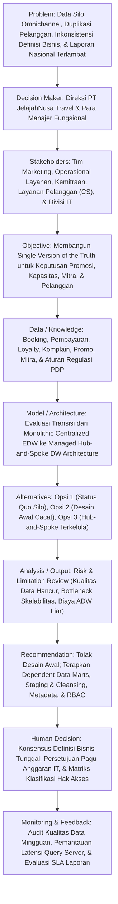

# LEMBAR KERJA DISKUSI SISTEM PENDUKUNG KEPUTUSAN
**FAKULTAS TEKNIK — UNIVERSITAS NEGERI YOGYAKARTA**  
*Mata Kuliah: Teori Sistem Pendukung Keputusan (Semester 5)*  
*Model Pembelajaran: Decision-Centered Structured Discussion (DCSD)*  
*Bahan Utama:* Turban, Sharda, & Delen (2011), *Decision Support and Business Intelligence Systems* (9th ed.), Bab 8: Gudang Data  
*Kelompok Analisis:* **Perspektif D (Critical Evaluation — Risk & Limitation Review)**  

---

> [!abstract] Petunjuk Penggunaan Template
> Gunakan template ini sebagai lembar kerja resmi diskusi kelompok. Sesuai Panduan Teori Pertemuan 10, **Bagian B** diisi mandiri sebelum kelas berdasarkan hasil penelaahan bahan bacaan Turban Bab 8. **Bagian C** dan **E** mengkaji Kasus Utama *Satu Versi Data untuk PT JelajahNusa Travel*. **Bagian D, F, dan G** memuat sintesis analisis inti 12 elemen DSS, evaluasi kritis mendalam terhadap kelemahan Desain Awal (*Perspektif D: Risk/Limitation Review*), serta rekomendasi arsitektur perbaikan terpadu kelompok.

---

## A. Identitas Pertemuan dan Kelompok

### Tabel 1: Cara Menggunakan Template
| Cara Menggunakan Template |
| :--- |
| Gunakan template yang sama pada seluruh pertemuan materi. Bagian C (Kasus/ Decision Problem) dan E (Elemen Khusus Topik) mengikuti Panduan Teori setiap minggu. LKD hanya memuat analisis kelompok sampai Kesimpulan dan Rekomendasi. |

### Tabel 2: Identitas Perkuliahan
| Pertemuan | Topik / Bab | Kelas | Kelompok | Perspektif |
| :---: | :--- | :---: | :---: | :---: |
| **10** | **Gudang Data untuk Dukungan Pengambilan Keputusan (Turban Bab 8)** | **A / B / F** *(Sesuaikan)* | **Kelompok [X]** | **Perspektif D — Critical Evaluation** |

> [!info] Panduan Pemilihan Perspektif (Berdasarkan Panduan Teori Pertemuan 10)
> - **Perspektif A (Concept & Theory)**: Uji kesesuaian dengan karakteristik DW, data mart/ODS/EDW, dan peran DW dalam DSS (*Concept-fit evaluation*).
> - **Perspektif B (Case & Implementation)**: Uji kebutuhan informasi, pengguna, tahap implementasi, sponsor, dan prioritas data (*Implementation evaluation*).
> - **Perspektif C (Method & Technology)**: Uji alur sources $\rightarrow$ ETL $\rightarrow$ DW/data mart $\rightarrow$ OLAP/BI/DSS, metadata, update frequency (*Architecture evaluation*).
> - **Perspektif D (Critical Evaluation - Kelompok Kami)**: Uji data quality, scalability, security/privacy, cost, scope, dan real-time trade-off (*Risk/limitation review*).
> - **Perspektif BC (Case, Method & Implementation)**: Khusus kelas 3 kelompok; menggabungkan penerapan kasus dengan alur metode/teknologi dari problem hingga recommendation dan human decision (*Integrated redesign*).

### Tabel 3: Tim Penyusun LKD
| Peran | Nama Mahasiswa | NIM | Catatan Kontribusi |
| :--- | :--- | :---: | :--- |
| **Presenter** | *[Nama Mahasiswa 1]* | *[NIM 1]* | Memimpin pemaparan evaluasi kritis terhadap Desain Awal PT JelajahNusa Travel |
| **Notulis** | *[Nama Mahasiswa 2]* | *[NIM 2]* | Mendokumentasikan sanggahan, tanggapan kritis, dan sintesis dinamika diskusi |
| **Anggota Kelompok** | 1. *[Nama Mahasiswa 3]* 2. *[Nama Mahasiswa 4]* 3. *[Nama Mahasiswa 5]* | *[NIM 3]* *[NIM 4]* *[NIM 5]* | Mengkaji risiko kualitas data, pemodelan arsitektur Hub-and-Spoke, dan trade-off real-time |

---

## B. Kesiapan dan Pemahaman Awal

Tuliskan minimal tiga konsep utama dari bahan bacaan/pertemuan.

### Tabel 4: Konsep Utama Bahan Bacaan (Turban Bab 8)
| Konsep Utama | Definisi Singkat | Hubungan dengan DSS/Keputusan |
| :--- | :--- | :--- |
| **1. Karakteristik Inti Data Warehouse (Subject-Oriented, Integrated, Time-Variant, Nonvolatile)** | Repositori data fisik terpusat yang diorganisasikan berdasarkan subjek bisnis utama (*subject-oriented*), menyatukan data dari berbagai sumber heterogen dengan format dan semantik terstandarisasi (*integrated*), mencatat jejak data historis berdimensi waktu (*time-variant*), serta bersifat hanya-baca dan tidak dapat diubah/ditimpa secara langsung oleh transaksi baru (*nonvolatile*). | Menjadi fondasi mutlak bagi DSS untuk menyediakan **Satu Versi Kebenaran (*Single Version of the Truth*)**. Tanpa integrasi semantik dan stabilitas historis (*nonvolatile*), DSS akan menghasilkan laporan yang saling bertentangan antarunit bisnis dan menggagalkan analisis tren jangka panjang. |
| **2. Ekstraksi, Transformasi, dan Pemuatan (ETL) & Data Cleansing** | Proses berurutan yang mengekstrak data dari sistem operasional/eksternal yang heterogen, membersihkan (*cleansing*) nilai anomali/duplikat, mengubah (*transforming*) format serta rekonsiliasi logika semantik bisnis ke skema seragam, dan memuat (*loading*) data ke dalam gudang data. | Menentukan validitas masukan DSS sesuai aksioma **"Garbage-In, Garbage-Out" (GIGO)**. Kualitas keputusan manajerial berbanding lurus dengan kualitas proses ETL; ETL yang buruk akan mempercepat eksekutif mengambil keputusan yang keliru secara terstruktur (*accelerated bad decisions*). |
| **3. Arsitektur Hub-and-Spoke vs. Centralized EDW (Inmon vs. Kimball)** | Dua paradigma arsitektur pergudangan data: *Centralized EDW* mengintegrasikan seluruh data ke satu basis data raksasa ternormalisasi (Inmon), sedangkan arsitektur *Hub-and-Spoke* melengkapi repositori pusat tersebut dengan *Dependent Data Marts* multidimensional terdesentralisasi yang melayani kebutuhan analitik spesifik departemen (Marketing, Finansial, Operasional). | Mempengaruhi kecepatan respons (*query response time*), skalabilitas beban pengguna, dan kemudahan akses pengambil keputusan. *Dependent Data Marts* mengisolasi beban komputasi analitik departemen sehingga pengguna dapat mengeksplorasi data secara lincah tanpa melumpuhkan server sentral perusahaan. |
| **4. Active Data Warehousing (ADW) & Real-Time Trade-off** | Lingkungan pergudangan data modern yang mampu menerima asupan data hampir seketika (*near real-time / continuous update*) untuk mendukung keputusan operasional taktis secara langsung (*event-driven decision making*), berbeda dari DW tradisional berbasis *nightly batch*. | Memberikan dukungan keputusan berkecepatan tinggi bagi operasional garis depan (*frontline decisions*), namun memicu **trade-off ekstrem**: biaya infrastruktur yang melonjak drastis, kompleksitas teknis tinggi, risiko inkonsistensi pelaporan antar-menit, serta beban komputasi berlebih yang sering kali tidak diperlukan oleh keputusan tingkat strategis. |
| **5. Tata Kelola Metadata & Keamanan Data (Role-Based Access Control)** | *Metadata* adalah data tentang data yang mendokumentasikan definisi bisnis, asal-usul data (*data lineage*), aturan transformasi teknis, dan hak akses. Keamanan DW mengatur otorisasi berbasis peran (*RBAC*), penyembunyian data privasi (*data masking*), serta jejak audit (*audit trail*). | Metadata menjamin pengambil keputusan memahami konteks dan definisi metrik yang dianalisis pada dashboard DSS, mencegah ambiguitas interpretasi, serta melindungi perusahaan dari risiko kebocoran data sensitif privasi konsumen (UU PDP) akibat akses analitik terbuka tanpa batas. |

 

### Tabel 5: Catatan Kesiapan dan Isu Diskusi
| Catatan awal kelompok | Hal yang masih perlu diklarifikasi saat diskusi |
| :--- | :--- |
| 1. **Data Warehouse Bukan Sekadar Database Operasional yang Diperbesar**: Database transaksional (OLTP) dirancang untuk pemrosesan transaksi cepat per baris (*read-write write-intensive*), sedangkan Data Warehouse (OLAP) dirancang untuk pembacaan dan analisis agregasi data dalam jumlah masif (*read-mostly / append-only*). Mencampuradukkan kedua filosofi ini akan merusak performa keduanya.  2. **Bahaya Integrasi Semu (*Syntactic vs. Semantic Integration*)**: Menyamakan format data (misalnya format tanggal atau tipe teks) belum menyelesaikan konflik semantik. Jika Unit Pemasaran dan Unit Operasional memiliki definisi rumus "Pelanggan Aktif" yang berbeda, maka menyimpan data ke dalam satu repositori fisik tanpa rekonsiliasi hanya akan menciptakan kebingungan terpusat (*centralized garbage dump*).  3. **Miskonsepsi "Real-Time Selalu Lebih Baik"**: Ambisi memaksakan seluruh data diperbarui secara *real-time* adalah perangkap teknologi (*technology bandwagoning*). Sebagian besar keputusan manajemen strategis (seperti evaluasi mitra bulanan dan alokasi promosi kuartalan) hanya membutuhkan *snapshot* data historis stabil per siklus penutupan buku (*point-in-time consistency*), bukan data instabil per detik yang membebani sistem. | 1. **Mekanisme Konsensus Rekonsiliasi Definisi Bisnis**: Bagaimana metodologi formal dalam DSS/DW untuk mendamaikan definisi bisnis yang berbenturan keras antarunit bisnis independen tanpa menimbulkan resistensi politik organisasi?  2. **Ambang Batas Latensi Data Optimal (*Data Freshness Threshold*)**: Bagaimana cara mengklasifikasikan secara presisi mana data transaksi yang mutlak membutuhkan *near real-time update* (misal ketersediaan kuota kursi perjalanan) versus data yang cukup diproses secara *nightly batch* (misal komputasi nilai *lifetime value* dan segmentasi pelanggan)?  3. **Strategi Isolasi Keamanan dalam Skema Konsolidasi**: Bagaimana merancang skema otorisasi dan kontrol akses berbasis peran (*RBAC*) pada arsitektur sentral agar staf analis departemen tidak dapat melihat data sensitif identitas pribadi (*PII*) pelanggan lintas saluran tanpa izin eksplisit? |

---

## C. Kasus / Isu / Decision Problem

### Tabel 6: Kasus/Isu dari Panduan Teori
| Kasus/Isu dari Panduan Teori |
| :--- |
| **Kasus Utama: Satu Versi Data untuk PT JelajahNusa Travel** *(Sumber: Panduan Mahasiswa Teori SPK Pertemuan 10, Halaman 3)*  **Kondisi Eksisting dan Masalah Bisnis:** PT JelajahNusa Travel menjual paket perjalanan melalui berbagai saluran penjualan (*omnichannel*), yaitu aplikasi seluler, situs web, *call center*, agen perjalanan luring, dan mitra pihak ketiga. Namun, saat ini data operasional perusahaan terfragmentasi dalam sistem yang saling terisolasi (*data silos*): data pemesanan (*booking*), transaksi pembayaran, program loyalitas (*loyalty*), keluhan pelanggan (*complaint*), promosi pemasaran, dan kinerja mitra berada pada basis data yang terpisah-pisah.  Kondisi ini menimbulkan dampak buruk langsung: 1. **Inkonsistensi Definisi Bisnis**: Definisi "pelanggan aktif" berbeda antarunit bisnis (misalnya unit aplikasi mendefinisikannya berdasarkan frekuensi pembukaan aplikasi, unit pemasaran berdasarkan histori transaksi 3 bulan terakhir, dan agen berdasarkan pemesanan paket tur dalam satu tahun berjalan). 2. **Anomali Kualitas Data**: Terjadi duplikasi data identitas pelanggan (*duplicate customers*) karena ketiadaan pengenal tunggal (*master customer ID*) lintas saluran. 3. **Keterlambatan Analisis**: Laporan konsolidasi kinerja nasional terlambat hingga beberapa hari karena harus direkonsiliasi dan digabungkan secara manual menggunakan spreadsheet yang rentan salah.  **Kebutuhan Dukungan Keputusan Direksi:** Direksi PT JelajahNusa Travel mendesak tersedianya fondasi data terintegrasi yang andal (*Single Version of the Truth*) untuk mendukung empat area keputusan strategis: 1. Penetapan dan alokasi efektivitas program promosi. 2. Perencanaan kapasitas layanan (alokasi armada transportasi, pemandu wisata, kuota akomodasi). 3. Evaluasi kinerja dan keberlanjutan kemitraan (agen dan mitra penyedia tur). 4. Analisis komprehensif perilaku dan nilai pelanggan (*customer lifetime value & retention*).  **Desain Awal yang Diusulkan Tim Internal (Objek Evaluasi Kritis):** Tim internal mengusulkan pembangunan **satu Enterprise Data Warehouse (EDW) pusat monolitik**. Seluruh data sumber operasional dimuat setiap malam (*nightly batch ETL*), dengan ketentuan data *cukup disamakan formatnya saja* sebelum dimuat. Semua unit bisnis diperbolehkan tetap menggunakan definisi bisnisnya masing-masing tanpa rekonsiliasi. Pada tahap berikutnya, seluruh data direncanakan akan diubah menjadi *real-time*. Akses analitik diberikan secara langsung ke banyak pengguna di seluruh perusahaan, sementara tanggung jawab atas tata kelola metadata, keamanan data, dan pemeliharaan kualitas data belum ditetapkan secara jelas. |

---

## D. Analisis Inti DSS — Wajib untuk Semua Kelompok

### Tabel 7: Benang Merah Alur Keputusan DSS
| Benang Merah Alur DSS |
| :--- |
| **Problem** (Silo data omnichannel, duplikasi profil pelanggan, inkonsistensi metrik antarunit, dan keterlambatan laporan nasional) $\rightarrow$ **Decision Maker** (Direksi PT JelajahNusa Travel dan jajaran Kepala Divisi Bisnis) $\rightarrow$ **Data/Knowledge** (Integrasi transaksi multi-kanal, aturan rekonsiliasi semantik, repositori metadata, dan batasan privasi) $\rightarrow$ **Model/Method** (Arsitektur Hub-and-Spoke dengan pemodelan dimensional Star Schema, pipeline ETL terstandarisasi, dan engine OLAP) $\rightarrow$ **Alternatives** (Status Quo vs. Desain Awal Sentral Tanpa Rekonsiliasi vs. Rekomendasi Hub-and-Spoke Terkelola) $\rightarrow$ **Analysis/Output** (Hasil telaah kritis risiko kualitas data GIGO, konkurensi query, ancaman kebocoran keamanan, dan pembengkakan biaya real-time) $\rightarrow$ **Recommendation** (Adopsi arsitektur terfederasi terkontrol dengan staging area, dependent data mart sektoral, tata kelola metadata, dan hybrid loading) $\rightarrow$ **Human Decision** (Otorisasi manajerial terhadap konsensus kamus definisi bisnis, pengesahan pagu anggaran infrastruktur, penentuan klasifikasi hak akses keamanan, dan pengecualian kebijakan operasional). |

### Tabel 8: Analisis 12 Elemen Inti DSS (Kasus PT JelajahNusa Travel)
| Elemen Inti DSS | Hasil Analisis Kelompok |
| :--- | :--- |
| **1. Problem / Opportunity** | **Problem**: Fragmentasi data (*data silos*) lintas saluran penjualan omnichannel (aplikasi, web, call center, agen, mitra), terjadinya duplikasi identitas pelanggan, inkonsistensi definisi "pelanggan aktif" antarunit, keterlambatan laporan nasional berhari-hari, serta tiadanya tata kelola metadata dan keamanan pada usulan desain awal. **Opportunity**: Mengembangkan repositori data analitik terintegrasi (*Single Version of the Truth*) yang mampu menyediakan bukti data akurat, konsisten, dan tepat waktu untuk mengoptimalkan profitabilitas dan keunggulan kompetitif perusahaan. |
| **2. Decision Maker / Problem Owner** | **Direksi PT JelajahNusa Travel** (*Chief Executive Officer, Chief Operating Officer, Chief Marketing Officer*) sebagai pemilik masalah strategis tertinggi yang memerlukan data terkonsolidasi nasional, didukung oleh jajaran Kepala Divisi Pemasaran, Kepala Divisi Operasional Layanan, Kepala Kemitraan Bisnis, dan *Chief Information Officer* (CIO) sebagai pengelola infrastruktur data. |
| **3. Stakeholders** | 1. **Tim Pemasaran & Promosi**: Pengguna data segmentasi, riwayat loyalitas, dan respons promosi. 2. **Tim Operasional Layanan**: Pengguna data proyeksi kebutuhan armada bus/kendaraan, tiket pesawat/kapal, dan kuota pemandu wisata. 3. **Tim Manajemen Kemitraan**: Pengguna metrik evaluasi kinerja agen lokal dan mitra penyedia tur. 4. **Tim Layanan Pelanggan (CS)**: Pihak yang membutuhkan profil riwayat keluhan dan kepuasan pelanggan secara utuh. 5. **Tim TI & Administrator Data Warehouse**: Penanggung jawab pipeline ETL, stabilitas server, kamus metadata, dan keamanan data. 6. **Mitra Agen & Penyedia Tur**: Pihak eksternal yang kinerjanya dievaluasi dan dipengaruhi oleh keakuratan data. 7. **Pelanggan Perjalanan**: Pihak yang merasakan langsung dampak ketepatan promosi, ketersediaan layanan, dan perlindungan privasi data pribadi mereka. |
| **4. Objective / Tujuan Keputusan** | 1. Mengeliminasi silo data dan mengonsolidasikan transaksi dari 5 saluran penjualan ke dalam satu arsitektur terintegrasi. 2. Menghilangkan anomali duplikasi identitas pelanggan dan mencapai kesepakatan satu definisi bisnis tunggal lintas departemen. 3. Memangkas waktu penyajian laporan nasional dari keterlambatan beberapa hari menjadi laporan harian tepat waktu (T+1). 4. Menyediakan dukungan data analitis yang terpercaya untuk empat area keputusan: (a) optimalisasi efektivitas promosi, (b) alokasi kapasitas layanan yang presisi, (c) evaluasi objektif kemitraan, dan (d) analisis retensi pelanggan. |
| **5. Data / Information / Knowledge** | - **Data Operasional Transaksional**: Catatan pemesanan (*booking log*), histori transaksi pembayaran (metode, nilai, waktu), transaksi poin program loyalitas, tiket keluhan/komplain pelanggan, riwayat penukaran voucer promosi, dan data log transaksi mitra agen. - **Information**: Laporan agregat pendapatan nasional per rute/kanal, tingkat keterisian kapasitas layanan (*seat occupancy rate*), rasio konversi kampanye promosi, skor kepuasan/keluhan pelanggan per paket tur, dan rasio pembatalan (*cancellation rate*) per mitra. - **Knowledge**: Definisi bisnis terstandardisasi mengenai siklus hidup pelanggan (*customer lifecycle*), aturan bisnis (*business rules*) perhitungan komisi dan penalti mitra, pola musiman liburan (*seasonality demand*), serta pemahaman batasan regulasi hukum privasi data (UU No. 27/2022 tentang Pelindungan Data Pribadi / PDP). |
| **6. Model / Method / Analysis** | - **Model Arsitektur Data**: Mengevaluasi kelemahan model *Centralized EDW* murni dan merekomendasikan transisi ke arsitektur **Hub-and-Spoke (Corporate Information Factory)** yang dilengkapi dengan *Dependent Data Marts* multidimensional. - **Model Integrasi & Pipeline ETL**: Menerapkan siklus *Extract-Transform-Cleanse-Load* yang ketat melalui *Staging Area*, algoritma pencocokan entitas (*entity matching & deduplication*), dan standardisasi semantik dimensi bersama (*Conformed Dimensions*). - **Model Analitik & Akses**: Pemodelan dimensional (*Star Schema*) dengan tabel fakta transaksi dan tabel dimensi (Waktu, Pelanggan, Saluran, Rute, Mitra), didukung oleh mesin *Online Analytical Processing (OLAP)* untuk analisis interaktif (*slicing, dicing, drill-down, roll-up*), pelaporan terformat rutin, dan dashboard visualisasi eksekutif. |
| **7. Alternatives / Options** | - **Opsi 1 (Status Quo - Bertahan pada Silo Data)**: Membiarkan sistem operasional terpisah di tiap unit; konsolidasi laporan tetap manual dengan spreadsheet (Risiko: lambat, inkonsisten, dan memicu salah keputusan). - **Opsi 2 (Desain Awal Tim Perusahaan - Cacat Fundamental)**: Membangun satu EDW pusat monolitik, nightly batch, hanya merapikan format data tanpa rekonsiliasi definisi bisnis, akses analitik langsung ke repositori pusat bagi semua user, rencana ambisius all real-time di masa depan, serta ketiadaan tata kelola metadata dan keamanan (Risiko: ledakan biaya, sistem kolaps, data sampah). - **Opsi 3 (Arsitektur Perbaikan Kelompok - Hub-and-Spoke Terkelola - Rekomendasi)**: Membangun EDW pusat ternormalisasi (3NF) sebagai repositori tunggal terintegrasi, membangun *Dependent Data Marts* multidimensional berbasis fungsi bisnis (Marketing, Operations, Partners), menerapkan deduplikasi di staging area, membangun kamus metadata terpadu, menerapkan RBAC, dan mengadopsi kebijakan *hybrid data freshness* (batch harian + near real-time selektif). |
| **8. Output / Evidence / Result** | - **Hasil Evaluasi Desain Awal**: Teridentifikasinya risiko fatal: laporan nasional tetap menghasilkan angka kontradiktif antarunit bisnis (*Single Version of the Lie*), waktu tunggu query pengguna menjadi sangat lama akibat perebutan *resource* di EDW pusat, potensi kebocoran data privasi pelanggan tanpa audit, serta pemborosan anggaran TI akibat memaksakan fitur real-time yang tidak layak. - **Hasil Desain Perbaikan**: Tersedianya dashboard eksekutif dan mart departemen yang menyajikan data konsisten; waktu respons query analitik di bawah hitungan detik; profil pelanggan tunggal yang bersih dari duplikasi (*Golden Customer Record*); dan laporan tren performa mitra yang dapat diaudit secara transparan. |
| **9. Recommendation** | **Menolak secara tegas Desain Awal** yang diusulkan oleh tim internal PT JelajahNusa Travel karena mengandung kecacatan metodologis yang membahayakan stabilitas finansial dan operasional perusahaan. Kelompok merekomendasikan pengesahan **Opsi 3 (Arsitektur Hub-and-Spoke Terkelola)** dengan urutan implementasi prioritas: (1) pembentukan komite tata kelola data untuk rekonsiliasi definisi bisnis, (2) pembangunan pipeline staging & cleansing ETL, (3) pembuatan EDW pusat dan dependent data mart bertahap, (4) penerapan kamus metadata dan keamanan berbasis RBAC, serta (5) membatalkan rencana *all real-time* dan menggantinya dengan kebijakan latensi berbasis kebutuhan nyata keputusan. |
| **10. Human Judgment / Final Decision** | Sistem pergudangan data hanya berfungsi sebagai **mesin penyedia bukti (*evidence engine*)**, sedangkan keputusan manajerial akhir tetap berada di tangan pengambil keputusan manusia (*human in the loop*): 1. Otoritas manajerial Direksi untuk menegakkan kompromi politik dan konsensus lintas divisi terkait definisi resmi tunggal "pelanggan aktif". 2. Penetapan alokasi anggaran belanja modal (CapEx) infrastruktur TI berdasarkan prioritas bisnis strategis. 3. Pertimbangan kualitatif dan intuisi bisnis dalam mengevaluasi pemutusan kontrak mitra agen bermasalah (mempertimbangkan relasi jangka panjang dan reputasi daerah yang tidak terekam dalam angka metrik). 4. Kebijakan otorisasi pengecualian akses data sensitif (*management override*) dan kepatuhan etika perlindungan privasi data pelanggan. |
| **11. Constraints / Risks / Uncertainty** | - **Constraints**: Keterbatasan pagu anggaran investasi TI; kapasitas keahlian teknis staf data internal yang terbatas; resistensi politik dari manajer unit bisnis yang enggan mengubah definisi kerja lokal mereka; dan batasan regulasi hukum privasi data (UU PDP). - **Risks**: Terjadinya kegagalan proyek DW (*runaway project*) jika *scope creep* tidak dikendalikan; risiko degradasi performa server pusat jika query analitik tidak diisolasi ke data mart; serta risiko penolakan pengguna (*user rejection*) bila data baru menghasilkan metrik yang mengejutkan atau memperlihatkan inefisiensi divisi. - **Uncertainty**: Volatilitas industri pariwisata akibat faktor eksternal tak terduga (misalnya cuaca ekstrem, fluktuasi harga bahan bakar pesawat, atau regulasi visa perjalanan mendadak) yang dapat mendistorsi pola historis yang terekam dalam data warehouse. |
| **12. Monitoring / Feedback (Jika Relevan)** | 1. Menerapkan *Data Quality Scorecard* berkala untuk melacak metrik kebersihan data (persentase data null, rasio duplikasi entitas yang tertolak, dan kepatuhan jadwal ETL harian). 2. Memonitor performa teknis sistem: rata-rata waktu pemrosesan query (*query execution latency*), utilisasi memori/CPU server, dan jumlah pengguna bersamaan (*concurrent user concurrency*). 3. Melakukan audit berkala terhadap log keamanan data untuk memastikan tiadanya akses tidak sah terhadap data pribadi sensitif. 4. Menyelenggarakan forum peninjauan berkala antara pengembang DW dan perwakilan unit bisnis untuk memperbarui aturan transformasi metadata seiring perkembangan model bisnis perusahaan. |

---

## E. Elemen Khusus Topik — Sesuai Panduan Pertemuan 10

### Tabel 9: Evaluasi Keterkaitan 6 Konsep Inti Bab 8 dengan Kasus PT JelajahNusa Travel
| No. | Elemen Khusus Topik | Hasil Analisis / Penjelasan Evaluasi Kritis Kelompok |
| :---: | :--- | :--- |
| **1** | **Karakteristik Data Warehouse (Subject-Oriented, Integrated, Time-Variant, Nonvolatile)** | **Kondisi Kasus & Benturan Teoretis:** - *Subject-Oriented*: PT JelajahNusa Travel memiliki subjek bisnis yang jelas (Pelanggan, Pemesanan, Mitra, Promosi). Desain awal sejalan dengan prinsip ini karena berupaya mengonsolidasikan subjek-subjek tersebut. - *Integrated (Benturan Keras)*: Karakteristik *integrated* mensyaratkan konsistensi nama variabel, struktur pengkodean, dan penafsiran semantik lintas sumber. Desain awal yang menyatakan *"semua unit memakai definisi bisnis yang sekarang tanpa rekonsiliasi"* secara fundamental **melanggar definisi dan karakteristik mutlak DW**. Membiarkan definisi pelanggan aktif berbeda di satu repositori menghancurkan integritas data. - *Time-Variant & Nonvolatile*: Pemuatan data secara *nightly batch* mendukung karakteristik *time-variant* dan *nonvolatile* (data transaksi masa lalu diarsipkan dan tidak ditimpa). Namun, ambisi mengubah seluruh data menjadi *real-time* di masa depan berisiko merusak stabilitas *nonvolatile*, karena data analitik akan terus berubah secara dinamis dan menghilangkan konsistensi titik waktu (*point-in-time snapshot*). |
| **2** | **Data Mart, ODS, EDW, dan Metadata** | **Kondisi Kasus & Benturan Teoretis:** - *Enterprise Data Warehouse (EDW)*: Desain awal langsung melompat mengusulkan satu EDW raksasa untuk mencakup seluruh perusahaan. Meskipun bertujuan menyatukan seluruh organisasi, membangun EDW raksasa dari atas ke bawah (*top-down Inmon approach*) tanpa tahapan yang realistis sangat rentan gagal karena kompleksitas integrasinya yang luar biasa tinggi (Turban Bab 8.5). - *Data Mart (Kelemahan Fatal)*: Desain awal sama sekali **tidak merancang Data Mart**. Akibatnya, seluruh beban analisis spesifik (analisis promosi oleh Marketing, analisis rute oleh Operasional) ditumpahkan langsung ke repositori pusat. Teori Turban menegaskan bahwa *Dependent Data Marts* sangat esensial untuk menyediakan subset data teragregasi yang disesuaikan dengan kebutuhan departemen. - *Metadata (Kelalaian Kritis)*: Desain awal mengakui bahwa *"tanggung jawab metadata belum ditetapkan secara jelas"*. Tanpa *Business Metadata* (kamus data terstandarisasi yang mendefinisikan arti "pelanggan aktif") dan *Technical Metadata* (pemetaan aturan ETL dan *data lineage*), pengguna tidak akan pernah mempercayai angka yang disajikan pada dashboard. |
| **3** | **ETL (Extract, Transform, Load) & Data Cleansing** | **Kondisi Kasus & Benturan Teoretis:** - *Miskonsepsi Fatal Tim Internal*: Desain awal mengasumsikan bahwa *"data cukup disamakan formatnya sebelum load"*. Ini adalah kekeliruan fatal yang sangat diperingatkan dalam teori Turban: menganggap ETL hanya sebatas memindahkan data dan konversi format sintaksis (misal menyeragamkan format tanggal DD/MM/YYYY atau mengonversi nilai angka). - *Pengabaian Data Cleansing & Deduplikasi*: Di PT JelajahNusa Travel, masalah utamanya adalah data kotor: pelanggan tercatat ganda lintas saluran (*duplicate customers*) dan ketiadaan kunci utama terpadu. Proses ETL sejati wajib mencakup fase *Staging Area* dan *Data Cleansing Algorithm* (misalnya menggunakan *deterministic or probabilistic record linkage*) untuk mengidentifikasi bahwa "Budi Santoso" yang memesan di aplikasi seluler adalah orang yang sama dengan yang memesan via call center. Tanpa deduplikasi pada tahap transformasi ETL, data warehouse hanya akan menjadi repositori sampah digital. |
| **4** | **Arsitektur Gudang Data & Pola Akses (Architecture & Access)** | **Kondisi Kasus & Benturan Teoretis:** - *Pilihan Arsitektur Awal (Centralized Data Warehouse)*: Desain awal mengadopsi model *Centralized DW Architecture without Data Marts* (Turban Bab 8.3, Gambar 8.12d). Arsitektur ini adalah yang paling rapuh jika diimplementasikan dalam skala besar dengan pengguna heterogen. - *Beban Akses Pengguna Langsung*: Usulan memberikan *"akses analitik langsung ke banyak pengguna"* ke satu EDW pusat melanggar praktik arsitektur terbaik (*best practices*). Membiarkan query analitik bebas (*ad-hoc SQL queries*) yang melibatkan operasi *table scan*, *group by*, dan *multi-table joins* dijalankan langsung pada basis data relasional pusat akan menimbulkan *query lock-ups* dan melumpuhkan sistem. - *Solusi Teoretis yang Terabaikan*: Teori merekomendasikan arsitektur *Hub-and-Spoke* (Gambar 8.12c) atau *Data Mart Bus Architecture* (Gambar 8.12b), di mana pengguna akhir mengakses data melalui *dependent data marts* berstruktur dimensional (*Star Schema*) yang dioptimalkan khusus untuk kecepatan agregasi OLAP. |
| **5** | **Active Data Warehousing (ADW) & Trade-off Real-Time** | **Kondisi Kasus & Benturan Teoretis:** - *Ambisi Irasional Tim Internal*: Desain awal berasumsi bahwa *"seluruh data dianggap perlu dibuat real-time pada tahap berikutnya"*. Usulan ini mencerminkan perangkap *technology bandwagoning* (mengadopsi teknologi mutakhir hanya karena teknologi itu ada). - *Evaluasi Teoretis Trade-off Turban (Bab 8.6)*: Turban secara eksplisit mencatat kekhawatiran besar seputar *Real-Time BI / Active DW*: (a) **Tidak semua data perlu diperbarui secara terus-menerus**; (b) **Biaya implementasi sangat mahal** (memerlukan teknologi EAI/EII berlisensi tinggi dan infrastruktur jaringan berkinerja ekstrem); (c) **Ketidaksesuaian laporan** (dua laporan manajerial yang ditarik berselang 10 menit akan menghasilkan angka agregat berbeda, memicu kebingungan audit); dan (d) **Kelayakan teknis yang rendah**. Keputusan strategis PT JelajahNusa (evaluasi mitra dan kapasitas rute) berorientasi tren berkala, sehingga pembaruan *nightly batch* sudah sangat memadai. Pembaruan *near real-time* hanya relevan untuk event operasional sempit (misalnya pemantauan kuota tiket mendesak). |
| **6** | **Skalabilitas, Keamanan Data, dan Tata Kelola (Scalability & Security)** | **Kondisi Kasus & Benturan Teoretis:** - *Skalabilitas yang Terancam (Turban Bab 8.7)*: Skalabilitas DW ditentukan oleh 4 pilar: volume data, laju pertumbuhan data, jumlah pengguna bersamaan (*concurrent users*), dan kompleksitas query. Desain awal gagal dalam pilar konkurensi dan kompleksitas query karena membuka akses langsung bagi banyak pengguna tanpa partisi atau data mart perantara. Skalabilitas linier mustahil tercapai dalam skema sentral tanpa buffering. - *Vakum Keamanan dan Privasi*: Menyerahkan akses ke banyak pengguna tanpa menetapkan tanggung jawab keamanan secara jelas adalah resep bencana hukum. Data perjalanan mengandung informasi sensitif privasi: nomor identitas kependudukan/paspor, riwayat mobilitas pribadi, detail pembayaran/rekening, dan riwayat komplain. Tanpa penerapan *Role-Based Access Control (RBAC)*, enkripsi data (*data masking*), dan jejak audit (*audit trail*), PT JelajahNusa Travel berada dalam ancaman sanksi hukum berat akibat pelanggaran regulasi pelindungan data pribadi konsumen (UU PDP). |

---

## F. Analisis Mendalam Sesuai Perspektif Kelompok

> [!warning] Fokus Perspektif Kelompok Kami: Perspektif D — Critical Evaluation
> Tugas utama kelompok adalah melakukan **uji kritis (Risk & Limitation Review)** terhadap Desain Awal PT JelajahNusa Travel. Analisis ini menyerang kelemahan metodologis dan teknis yang diusulkan tim internal dengan menggunakan argumen berbasis teori dari buku Turban et al. (2011) Bab 8. Evaluasi mendalam berfokus pada:
> 1. Risiko Kualitas Data (ketiadaan rekonsiliasi definisi bisnis dan ilusi format).
> 2. Keterbatasan Skalabilitas & Ancaman Bottleneck (akses query analitik langsung tanpa Data Mart).
> 3. Kerentanan Keamanan Data, Privasi, dan Tiadanya Audit Trail.
> 4. Trade-off Irasional Biaya vs Waktu Nyata (Kritik Ambisi All Real-Time / Active DW).
> 5. Kegagalan Tata Kelola Metadata dan Risiko Scope Creep Proyek.

### Tabel 10: Panduan Perspektif Diskusi
| Perspektif | Fokus Analisis |
| :--- | :--- |
| **A - Concept & Theory** | Jelaskan konsep utama, komponen/tahapan, hubungan antarkonsep, dan hubungannya dengan proses keputusan/DSS. |
| **B - Case & Implementation** | Terapkan konsep pada kasus: problem, decision maker, alternatif, rekomendasi, serta bagaimana keputusan diterapkan. |
| **C - Method & Technology** | Jelaskan input-process-output, cara kerja model/metode/teknologi, dan bagaimana hasilnya menjadi decision support. |
| **D - Critical Evaluation (Kelompok Kami)** | **Uji asumsi, kualitas evidence, keterbatasan, risiko, uncertainty, trade-off, dan batas human judgment.** |
| **BC - Case, Method & Implementation** | Untuk kelas 3 kelompok: gabungkan penerapan kasus dengan alur metode/teknologi dari problem hingga recommendation dan human decision. |

### Tabel 11: Uraian Analisis Mendalam Perspektif D (Critical Evaluation — Risk & Limitation Review)
| No. | Dimensi Uji Kritis | Uraian Analisis Mendalam Kelompok (Perspektif D) |
| :---: | :--- | :--- |
| **1** | **Risiko Kualitas Data Akut dan Ilusi Integrasi: Bahaya Format Conversion Tanpa Semantic Reconciliation dan Deduplikasi ("Garbage In, Garbage Out")** | **Landasan Teori (Turban Bab 8.2 & 8.4):** Prinsip fundamental dari sebuah *Data Warehouse* menurut W.H. Inmon adalah karakteristik **Terintegrasi (*Integrated*)**. Integrasi data bukan semata-mata menyamakan format penulisan (seperti mengubah format tanggal, tipe data desimal, atau representasi *string*), melainkan menyelaraskan logika semantik, mengatasi konflik terminologi, dan melakukan standardisasi nilai kode dari sumber data yang heterogen.  **Kritik Terhadap Desain Awal:** Tim PT JelajahNusa Travel melakukan simplifikasi yang sangat fatal dengan berasumsi bahwa *"data cukup disamakan formatnya sebelum load"* dan membiarkan *"semua unit memakai definisi bisnis yang sekarang tanpa rekonsiliasi"*. Pendekatan ini adalah ilusi integrasi (*pseudo-integration*). Ketika sistem menyerap data dari aplikasi, situs web, agen, dan mitra tanpa rekonsiliasi semantik, data warehouse yang dibangun tidak lebih dari sebuah **"Tempat Pembuangan Sampah Digital Terpusat" (*Centralized Data Landfill*)**.  **Dampak Keputusan & Risiko Fatal (Risk Review):** 1. *Metrik Kontradiktif*: Jika Unit Pemasaran mendefinisikan "pelanggan aktif" sebagai pengguna yang berbelanja dalam 3 bulan terakhir, Unit Aplikasi mendefinisikannya sebagai pengguna yang membuka aplikasi dalam 30 hari terakhir, dan Unit Agen mendefinisikannya sebagai orang yang pernah memesan tur dalam 12 bulan terakhir, maka dashboard eksekutif akan menyajikan angka jumlah pelanggan yang saling bertentangan secara ekstrem. Direksi tidak akan pernah memperoleh **Satu Versi Kebenaran (*Single Version of the Truth*)**, melainkan justru mempercepat lahirnya perdebatan politik antardivisi mengenai angka siapa yang benar. 2. *Distorsi Alokasi Anggaran (Aksioma GIGO)*: Direksi yang mengalokasikan anggaran promosi berbasis metrik pelanggan yang bias akan memboroskan modal pada segmen yang salah. Karena duplikasi identitas pelanggan tidak dibersihkan di fase ETL, seorang pelanggan yang memesan via web dan mengajukan komplain via call center akan diperlakukan sebagai dua entitas yang berbeda, merusak validitas analisis nilai seumur hidup pelanggan (*Customer Lifetime Value*). |
| **2** | **Kerapuhan Arsitektur dan Keterbatasan Skalabilitas: Ancaman Bottleneck Komputasi Akibat Akses Query Analitik Langsung Tanpa Dependent Data Marts** | **Landasan Teori (Turban Bab 8.3 & 8.7; Ariyachandra & Watson, 2006):** Skalabilitas sebuah gudang data diukur dari kemampuannya mempertahankan performa sistem secara proporsional linier ketika terjadi lonjakan pada empat pilar: (1) volume data, (2) laju pertumbuhan data, (3) jumlah pengguna bersamaan (*concurrent users*), dan (4) kompleksitas permintaan pengguna (*query complexity*). Teori arsitektur DW menegaskan bahwa pemrosesan analitik berskala korporat memerlukan arsitektur berlapis, seperti **Arsitektur Hub-and-Spoke**, di mana repositori pusat (*Enterprise DW*) bertindak sebagai *hub* data ternormalisasi, sedangkan *Dependent Data Marts* bertindak sebagai *spokes* multidimensional yang melayani kebutuhan analitik departemen secara terisolasi.  **Kritik Terhadap Desain Awal:** Desain awal memilih model *Centralized Data Warehouse Architecture without Data Marts* dan secara gegabah memberikan *"akses analitik langsung ke banyak pengguna"*. Usulan ini mengabaikan fakta dasar bahwa beban kerja analitik (OLAP) memiliki sifat *query-heavy* dan memakan sumber daya I/O serta memori yang sangat besar (operasi agregasi multi-tabel, *table scans*, *nested subqueries*).  **Dampak Keputusan & Risiko Fatal (Risk Review):** 1. *System Crash & Query Lock-Ups*: Ketika puluhan analis pemasaran, manajer operasional rute, dan staf kemitraan secara serentak mengeksekusi query ad-hoc yang belum dioptimalkan langsung ke repositori pusat, server sentral akan mengalami perebutan sumber daya (*resource contention*) yang parah. Fenomena ini memicu degradasi waktu respons secara drastis (*query bottleneck*) hingga potensi kelumpuhan server total (*out-of-memory crash*). 2. *Inkompatibilitas Terhadap Kebutuhan Pengguna*: Pengguna bisnis pada umumnya tidak memiliki keahlian menulis query SQL relasional ternormalisasi (3NF) yang rumit pada EDW pusat. Ketiadaan *Dependent Data Marts* berbasis skema bintang (*Star Schema*) yang mudah dipahami menyebabkan pengguna frustrasi, lambat mendapatkan laporan operasional, dan akhirnya kembali mengandalkan spreadsheet lokal tidak resmi (*rogue spreadsheets*), yang menggagalkan tujuan adopsi DSS perusahaan secara menyeluruh. |
| **3** | **Kerentanan Keamanan Data, Kegagalan Privasi, dan Tiadanya Audit Trail: Pelanggaran Prinsip Least Privilege dan Regulasi PDP** | **Landasan Teori (Turban Bab 8.7 - Security and Privacy):** Pengelolaan data warehouse skala besar menuntut kebijakan tata kelola keamanan yang ketat. Mengingat DW mengonsolidasikan seluruh aset data historis perusahaan ke dalam satu wadah fisik, DW menjadi target yang sangat empuk bagi ancaman kebocoran data (*data breach*). Standar tata kelola data industri mewajibkan penerapan prinsip **Hak Akses Terendah (*Principle of Least Privilege*)** melalui *Role-Based Access Control (RBAC)*, pemisahan lingkungan, penyamaran data sensitif (*data masking/tokenization*), dan pencatatan riwayat penelusuran (*audit logging*).  **Kritik Terhadap Desain Awal:** Desain awal tim PT JelajahNusa Travel secara terang-terangan mengakui bahwa *"akses analitik diberikan langsung ke banyak pengguna, sementara tanggung jawab metadata, keamanan, dan kualitas data belum ditetapkan secara jelas"*. Ini adalah kelalaian tata kelola data yang sangat fatal (*governance failure*). Memberikan akses bebas kepada banyak staf internal ke repositori pusat tanpa kontrol otorisasi berjenjang sama dengan membuka brankas rahasia perusahaan tanpa pengawasan.  **Dampak Keputusan & Risiko Fatal (Risk Review):** 1. *Eksposur Data Sensitif Pelanggan (PII)*: Dalam bisnis biro perjalanan, data mencakup informasi identitas pribadi sensitif (*Personally Identifiable Information*), seperti nomor paspor, NIK KTP, data kartu kredit/transaksi perbankan, riwayat perjalanan keluarga, hingga riwayat keluhan medis/khusus. Tanpa pembatasan peran, staf pemasaran atau operasional biasa dapat melihat profil pribadi pelanggan secara telanjang, yang melanggar hukum secara serius (seperti UU Pelindungan Data Pribadi / UU PDP di Indonesia) dan membuka risiko tuntutan pidana serta ganti rugi perdata yang masif. 2. *Vakum Akuntabilitas*: Ketiadaan penunjukan resmi peran *Data Administrator* atau *Chief Security Officer* menyebabkan tiadanya pencatatan log audit (*audit trail*). Bila terjadi insiden pembocoran data pelanggan ke pihak pesaing atau penjualan basis data kontak oleh oknum internal, perusahaan tidak memiliki bukti digital forensik untuk mengidentifikasi siapa pelaku yang mengeksekusi query pencurian data tersebut. |
| **4** | **Irasionalitas Trade-off Biaya vs Waktu Nyata: Ambisi "All Real-Time" (Active DW) Tanpa Justifikasi Bisnis dan Analisis Kelayakan Finansial** | **Landasan Teori (Turban Bab 8.6; Watson et al., 2006):** Konsep *Active Data Warehousing (ADW)* atau pergudangan data waktu nyata (*Real-Time DW*) memang memungkinkan sinkronisasi data seketika (*event-driven update*). Namun, literatur akademik Turban secara tegas mengingatkan bahwa penerapan real-time BI membawa tantangan ekstrem yang harus ditimbang matang: (a) *Tidak semua keputusan membutuhkan data real-time*; (b) *Biaya infrastruktur sangat mahal*; (c) *Risiko inkonsistensi pelaporan antar-menit*; dan (d) *Tingkat kelayakan teknis yang rendah bagi organisasi yang belum matang secara data*.  **Kritik Terhadap Desain Awal:** Tim PT JelajahNusa Travel terjebak dalam perangkap mentalitas *technology bandwagoning* dengan menyatakan bahwa *"seluruh data dianggap perlu dibuat real-time pada tahap berikutnya"*. Usulan ini tidak didasarkan pada analisis kebutuhan keputusan (*decision requirements analysis*), melainkan sekadar ilusi bahwa semakin cepat data diperbarui, maka keputusan otomatis semakin baik. Ini adalah asumsi yang salah dan membahayakan kesehatan finansial perusahaan.  **Dampak Keputusan & Risiko Fatal (Risk Review):** 1. *Pembengkakan Biaya Investasi dan Lisensi (Exploding Cost)*: Membangun arsitektur *Continuous Streaming ETL* dan *Active DW* membutuhkan lisensi perangkat lunak *Enterprise Application Integration (EAI)* atau *Enterprise Information Integration (EII)* berharga miliaran rupiah, ditambah kebutuhan perangkat keras komputasi berkecepatan tinggi dengan redundansi tinggi. Memaksakan teknologi ini tanpa justifikasi bisnis yang jelas akan menguras kas modal (CapEx) perusahaan tanpa memberikan nilai pengembalian investasi (*ROI*) yang rasional. 2. *Ketidaksesuaian Kebutuhan Keputusan Strategis*: Empat mandat keputusan Direksi (alokasi anggaran promosi kuartalan, evaluasi mitra berkala, perencanaan kapasitas rute musiman, dan analisis segmen pelanggan) adalah **keputusan strategis dan taktis jangka menengah-panjang**, bukan keputusan operasional per detik. Keputusan ini justru memerlukan data agregat yang stabil, tervalidasi, dan memiliki titik potong waktu konsisten (*point-in-time snapshot*). Jika data promosi berubah setiap 3 detik, laporan analisis efektivitas kampanye yang ditarik oleh Direktur Pemasaran pada pukul 09.00 akan berbeda dengan laporan yang ditarik Direktur Keuangan pada pukul 09.15, memicu perdebatan sia-sia akibat ketidakstabilan data (*data volatility risk*). |
| **5** | **Ketiadaan Tata Kelola Metadata dan Risiko Scope Creep: Kegagalan Menetapkan Data Ownership dan Manajemen Ekspektasi Proyek** | **Landasan Teori (Turban Bab 8.2 & 8.5; Best Practices & Risks in DW Implementation):** Turban et al. merangkum bahwa penyebab utama kegagalan proyek Data Warehouse bukan terletak pada kegagalan perangkat keras, melainkan pada aspek manajerial: *ketiadaan sponsor yang kuat*, *masalah politik dan perebutan wilayah (territorial turf battles)*, *data sumber yang tidak dipahami*, *perluasan ruang lingkup tanpa kendali (scope creep)*, dan *ketiadaan pengelolaan metadata*. Metadata adalah repositori pengetahuan yang bertindak sebagai "buku manual" dan "sistem navigasi" bagi seluruh ekosistem gudang data.  **Kritik Terhadap Desain Awal:** Fakta bahwa tim awal menyatakan *"tanggung jawab metadata, keamanan, dan kualitas data belum ditetapkan secara jelas"* membuktikan bahwa proyek ini dijalankan dengan orientasi teknologi sempit (*technology-driven*) tanpa tata kelola (*governance-blind*). Proyek dimulai tanpa ada penunjukan resmi siapa pemilik data (*Data Owner*) dan siapa pengelola data (*Data Steward*) di masing-masing unit bisnis.  **Dampak Keputusan & Risiko Fatal (Risk Review):** 1. *Ketiadaan Konteks Data (The "Blind Query" Dilemma)*: Tanpa *Technical Metadata*, tim pengembang tidak memiliki dokumentasi asal-usul data (*data lineage*), aturan transformasi, dan jadwal pembaruan, sehingga pemeliharaan sistem di masa depan akan mustahil dilakukan jika personel kunci keluar dari perusahaan (*key personnel turnover*). Tanpa *Business Metadata*, pengguna analitik tidak akan mengetahui arti metrik yang mereka gunakan, rumus perhitungannya, atau batasan validitasnya, yang berujung pada kesalahan interpretasi data yang fatal. 2. *Resistensi Politik dan Kegagalan Adopsi Proyek*: Tanpa adanya kesepakatan formal mengenai tata kelola data, manajer unit bisnis akan tetap mempertahankan sistem silonya masing-masing karena merasa otoritas mereka terancam (*political territorial issues*). Proyek pembangunan DW akan terseret ke dalam perangkap perluasan lingkup tanpa batas (*scope creep*), molor dari tenggat waktu, melampaui anggaran, dan pada akhirnya ditinggalkan oleh pengguna (*project abandonment*), menyisakan kerugian investasi yang masif bagi PT JelajahNusa Travel. |

---

## G. Kesimpulan dan Rekomendasi Kelompok

### Tabel 12: Kesimpulan dan Rekomendasi Akhir
| Komponen | Isian Analisis Kelompok |
| :--- | :--- |
| **Kesimpulan Utama** *(Maksimal 100 kata)* | Desain awal PT JelajahNusa Travel cacat secara fundamental dan berisiko tinggi gagal. Membangun EDW tanpa rekonsiliasi semantik definisi bisnis dan deduplikasi entitas melanggar prinsip *Single Version of the Truth* serta menghasilkan fenomena *Garbage-In Garbage-Out*. Akses analitik langsung tanpa *dependent data mart* memicu *bottleneck* skalabilitas dan ancaman keamanan data. Selain itu, ambisi memaksakan seluruh data *real-time* merupakan pemborosan biaya tanpa kelayakan teknis. Perusahaan harus mengadopsi arsitektur *Hub-and-Spoke* terkelola dengan *dependent data mart*, tata kelola metadata terpadu, dan pembaruan data bertahap. *(80 kata)* |
| **Rekomendasi / Keputusan Kelompok** | 1. **Peralihan Arsitektur Menjadi Hub-and-Spoke (Corporate Information Factory)**: Menghentikan usulan akses langsung ke EDW sentral. Membangun arsitektur *Hub-and-Spoke* yang menempatkan EDW ternormalisasi (3NF) sebagai repositori inti terintegrasi (*hub*), dan membangun **Dependent Data Marts** multidimensional bertahap (*spokes*) dengan skema bintang (*Star Schema*) untuk masing-masing divisi (Data Mart Pemasaran & Promosi, Data Mart Operasional Layanan, dan Data Mart Manajemen Kemitraan) guna menjamin skalabilitas query dan kenyamanan pengguna.  2. **Standardisasi Pipeline ETL & Staging Area untuk Resolusi Entitas**: Mewajibkan adanya lapisan *Staging Area* sebelum pemuatan ke data warehouse. Mengimplementasikan algoritma pembersihan data (*Data Cleansing Engine*) untuk melakukan deduplikasi data pelanggan (*customer record linkage*) lintas saluran (aplikasi, web, call center, agen, mitra) guna membentuk satu pengenal pelanggan tunggal (*Golden Master Customer ID*).  3. **Pembentukan Dewan Tata Kelola Data (*Data Governance Council*) & Metadata Repository**: Membentuk komite gabungan lintas divisi (Bisnis dan TI) yang dipimpin oleh *Data Governance Officer*. Tugas utamanya adalah menegakkan konsensus resmi mengenai kamus definisi bisnis (khususnya definisi operasional tunggal "Pelanggan Aktif") dan membangun *Central Metadata Repository* yang mendokumentasikan *business metadata* serta *technical lineage* data.  4. **Penerapan Kebijakan Pembaruan Data Hibrida (*Hybrid Data Freshness Policy*)**: Membatalkan ambisi irasional memaksakan seluruh data menjadi *real-time*. Menerapkan kebijakan pembaruan data berjenjang: sebagian besar data analitik historis untuk keputusan promosi, kapasitas, dan mitra diproses secara **Nightly Batch ETL** (memenuhi konsistensi titik waktu dan hemat biaya), sedangkan pembaruan data mendekati waktu nyata (**Near Real-Time**) hanya diterapkan secara selektif pada entitas operasional sempit yang kritis (seperti ketersediaan kuota kursi/kamar mendesak).  5. **Penerapan Keamanan Berlapis (*Role-Based Access Control* & Privasi Data)**: Menutup akses analitik langsung ke EDW pusat. Menerapkan kontrol akses berbasis peran (*RBAC*) pada lapisan Data Mart dan alat visualisasi OLAP/BI. Mengimplementasikan teknik penyamaran data sensitif (*data masking*) untuk informasi pribadi pelanggan (NIK, nomor paspor, detail pembayaran) guna mematuhi Undang-Undang Pelindungan Data Pribadi (UU PDP), serta mengaktifkan pencatatan jejak audit (*audit logging*) secara menyeluruh. |
| **Tingkat Keyakinan** | **Tinggi (High Confidence)** |
| **Alasan Tingkat Keyakinan** | Rekomendasi kelompok didasarkan pada kerangka kerja arsitektur industri teruji (model Corporate Information Factory oleh W.H. Inmon) dan bukti empiris dari studi Ariyachandra & Watson (2006) sebagaimana diulas dalam literatur Turban et al. (Bab 8). Solusi ini secara langsung meredam lima risiko fatal dari desain awal (kualitas data buruk, kegagalan skalabilitas, pelanggaran privasi, lonjakan biaya real-time, dan kegagalan tata kelola), serta menjamin terpenuhinya empat kebutuhan keputusan strategis Direksi PT JelajahNusa Travel secara realistis, hemat biaya, dan berkelanjutan. |
| **Data / Informasi Tambahan yang Masih Dibutuhkan** | 1. **Metrik Volume Data Transaksi & Proyeksi Pertumbuhan**: Data historis mengenai volume transaksi harian dari masing-masing saluran penjualan (jumlah transaksi harian aplikasi vs web vs call center vs agen) serta proyeksi pertumbuhannya untuk 3–5 tahun ke depan guna merancang kapasitas penyimpanan dan partisi basis data. 2. **Profil Beban dan Konkurensi Pengguna Analitik**: Data kuantitatif mengenai estimasi jumlah pengguna analitik bersamaan (*peak concurrent users*), jam-jam sibuk eksekusi query, serta tingkat kemahiran teknis staf bisnis untuk menentukan kebutuhan lisensi alat BI/OLAP. 3. **Spesifikasi Service Level Agreement (SLA) Pelaporan**: Kebutuhan latensi data formal dari masing-masing kepala divisi (misalnya: toleransi waktu pembaruan data promosi apakah harian atau mingguan, dan batasan toleransi keterlambatan laporan nasional). 4. **Pagu Alokasi Anggaran Investasi TI (CapEx & OpEx)**: Batasan plafon anggaran modal dan operasional yang disediakan oleh Direksi untuk pengadaan perangkat keras, lisensi piranti lunak ETL/DBMS, dan biaya konsultan/rekayasa data. 5. **Matriks Konsensus Awal Definisi Bisnis**: Rekam data mengenai perbedaan definisi istilah bisnis yang saat ini digunakan di lapangan oleh masing-masing manajer divisi untuk memetakan kesenjangan (*gap analysis*) sebelum sesi musyawarah rekonsiliasi data. |

---

> [!check] Verifikasi Akhir Format LKD Sesuai Template
> - Seluruh struktur tabel (Tabel 1 hingga Tabel 12) telah disusun secara lengkap, sistematis, dan presisi mengikuti urutan berkas `Template - LKD_SPK (4).docx`.
> - Bagian F berfokus penuh pada **Perspektif D (Critical Evaluation)** dengan 5 poin analisis kritis yang menyerang kelemahan Desain Awal PT JelajahNusa Travel berbasis teori Turban Bab 8.
> - Batasan jumlah kata pada Kesimpulan Utama (Tabel 12) ditaati secara ketat (**80 kata**, di bawah batas maksimum 100 kata).
> - Seluruh fakta kasus didasarkan murni pada studi kasus PT JelajahNusa Travel dari Panduan Teori Pertemuan 10 tanpa mengarang fakta di luar kasus.
