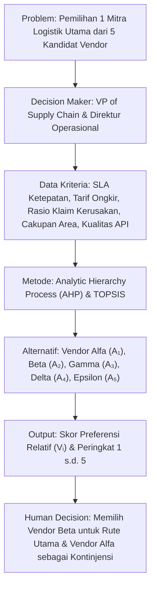
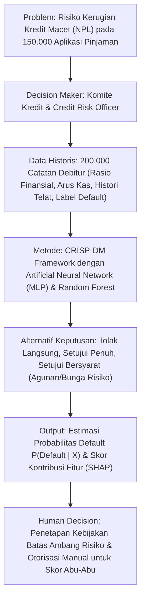
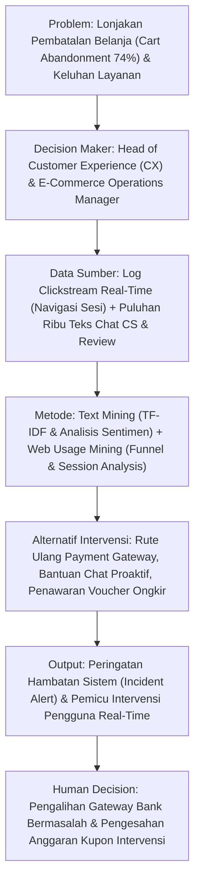
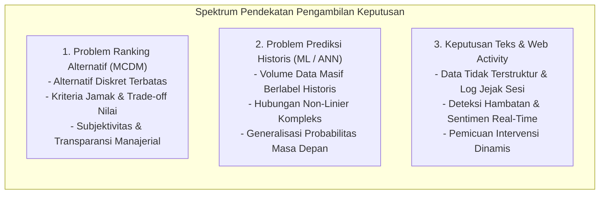

# Tiga Contoh Problem Keputusan Nyata dalam SPK
*Tugas Persiapan Sebelum Kelas: Membawa Satu Contoh Problem Ranking Alternatif, Satu Problem Prediksi dari Data Historis, dan Satu Keputusan Berbasis Teks atau Aktivitas Web*

---

> [!abstract] Ikhtisar Dokumen
> Dokumen ini disusun untuk memenuhi tugas persiapan perkuliahan Teori SPK Pertemuan 9 (Bagian D, butir 2 dan 3). Dokumen ini menyajikan 3 studi kasus nyata yang dirancang secara terstruktur dengan benang merah DSS: **Problem $\rightarrow$ Decision Maker $\rightarrow$ Data $\rightarrow$ Model $\rightarrow$ Alternatives $\rightarrow$ Output $\rightarrow$ Human Decision**. Setiap kasus mengilustrasikan kapan suatu masalah tepat diselesaikan dengan **MCDM**, kapan harus menggunakan **Predictive Machine Learning / ANN**, dan kapan memerlukan **Text & Web Usage Mining**.

---

## 1. Problem Ranking Alternatif (Pendekatan MCDM)

### 1.1 Judul Studi Kasus
**Seleksi dan Perankingan Mitra Logistik Pihak Ketiga (3PL / Third-Party Logistics) untuk Distribusi Nasional E-Commerce**

### 1.2 Karakteristik Masalah & Alasan Kesesuaian Metode (Method Fit)
- **Karakteristik**:
  - Terdapat kumpulan alternatif diskret yang terbatas dan sudah teridentifikasi secara jelas (5 vendor logistik: $A_1, A_2, A_3, A_4, A_5$).
  - Keputusan melibatkan kriteria jamak yang saling bertolak belakang (*conflicting criteria*), di mana tarif pengiriman murah sering kali berbanding terbalik dengan kecepatan dan keandalan layanan (*trade-off*).
  - Tidak tersedia dataset historis berisi jutaan baris keputusan masa lalu yang berlabel untuk dilatih dengan machine learning.
- **Mengapa Harus MCDM (Bukan Machine Learning / ANN)?**:
  Masalah ini murni merupakan evaluasi komparatif multi-kriteria berbasis preferensi subjektif manajemen puncak. Menggunakan Machine Learning pada kasus ini adalah bentuk *over-engineering* yang keliru karena tidak ada fungsi regresi atau probabilitas masa depan yang perlu dipelajari dari data besar. Yang dibutuhkan adalah pembobotan terstruktur atas pertimbangan prioritas bisnis perusahaan.

### 1.3 Formulir Elemen DSS Kasus 1

| Elemen DSS | Uraian Kasus Nyata |
| :--- | :--- |
| **Problem / Opportunity** | Perusahaan e-commerce mengalami lonjakan volume pengiriman antar-pulau sebesar 300% dan menghadapi keluhan keterlambatan barang. Manajemen harus memilih 1 mitra logistik utama (3PL) untuk kontrak jangka panjang 3 tahun dari 5 vendor yang lolos prakualifikasi tender. |
| **Decision Maker** | *Vice President of Supply Chain Management* bersama Direktur Operasional. |
| **Stakeholders** | Tim Pergudangan (Fulfillment), Tim Keuangan (Finance), Merchant/Penjual di platform, dan Konsumen Akhir. |
| **Objective** | Memilih mitra 3PL yang memberikan rasio keandalan layanan (*Service Level Agreement*) tertinggi dengan biaya operasional yang kompetitif dan jangkauan wilayah terluas. |
| **Kriteria & Bobot** | 1. **Biaya Rata-Rata per Kg ($C_1$ - Cost)**: Bobot 25% 2. **Ketepatan Waktu / SLA On-Time Delivery ($C_2$ - Benefit)**: Bobot 30% 3. **Rasio Kehilangan / Kerusakan Paket ($C_3$ - Cost)**: Bobot 20% 4. **Jangkauan Wilayah Pelosok / Kecamatan ($C_4$ - Benefit)**: Bobot 15% 5. **Kesiapan Integrasi IT & Pelacakan API Real-Time ($C_5$ - Benefit)**: Bobot 10% |
| **Model / Method** | Kombinasi **AHP (Analytic Hierarchy Process)** untuk menentukan bobot prioritas kriteria yang konsisten ($CR < 0.10$), dilanjutkan dengan **TOPSIS (Technique for Order of Preference by Similarity to Ideal Solution)** untuk merangking vendor berdasarkan jarak terdekat terhadap solusi ideal positif ($A^+$) dan jarak terjauh dari solusi ideal negatif ($A^-$). |
| **Alternatif** | $A_1$ (Logistik Kilat Nusantara), $A_2$ (Ekspres Prima Jaya), $A_3$ (Trans Global Kargo), $A_4$ (Cepat Aman Kurir), $A_5$ (Sentra Kirim Mandiri). |
| **Output / Evidence** | Nilai preferensi kedekatan relatif ($V_i$): - $A_2$ (Ekspres Prima): $V_2 = 0.842$ (Peringkat 1) - $A_1$ (Kilat Nusantara): $V_1 = 0.765$ (Peringkat 2) - $A_4$ (Cepat Aman): $V_4 = 0.589$ (Peringkat 3) - $A_3$ (Trans Global): $V_3 = 0.412$ (Peringkat 4) - $A_5$ (Sentra Kirim): $V_5 = 0.301$ (Peringkat 5) |
| **Human Judgment / Final Decision** | Manajemen menetapkan **Vendor $A_2$ (Ekspres Prima)** sebagai penerima kontrak utama (alokasi 70% volume pengiriman). Namun, demi mitigasi risiko kelumpuhan operasional (*single point of failure*), manajemen menggunakan pertimbangan kebijakan (*policy override*) dengan memberikan alokasi sisa 30% kepada **Vendor $A_1$ (Kilat Nusantara)** sebagai mitra kontinjensi untuk rute pelosok Indonesia Timur. |

---

## 2. Problem Prediksi dari Data Historis (Pendekatan Supervised Machine Learning / ANN)

### 2.1 Judul Studi Kasus
**Prediksi Risiko Gagal Bayar (Credit Default Risk) Pinjaman Modal Kerja UMKM pada Platform Finansial / P2P Lending**

### 2.2 Karakteristik Masalah & Alasan Kesesuaian Metode (Method Fit)
- **Karakteristik**:
  - Tersedia repositori data historis masif (200.000 data pengajuan pinjaman selama 5 tahun terakhir) yang telah memiliki label ground-truth status akhir ($y \in \{0, 1\}$: 0 = Kredit Lancar, 1 = Gagal Bayar / *Default*).
  - Terdapat hubungan non-linier yang rumit dan interaksi multi-variabel antara rasio likuiditas, omzet bulanan, perputaran kas, frekuensi keterlambatan rekening koran, serta tren industri debitur.
  - Skala pengajuan harian sangat besar (ribuan aplikasi per hari), sehingga mustahil dianalisis manual satu per satu menggunakan pembobotan kriteria statis.
- **Mengapa Harus Data-Driven Machine Learning / ANN (Bukan MCDM)?**:
  Masalah ini membutuhkan kemampuan **generalisasi fungsi pemetaan probabilitas** dari data empiris masa lalu untuk memproyeksikan kejadian masa depan (*predictive task*). Nilai bobot hubungan antar variabel tidak dapat ditentukan hanya dari opini subjektif pakar kredit, melainkan harus dipelajari secara matematis dari pola objektif data kegagalan bayar masa lalu.

### 2.3 Formulir Elemen DSS Kasus 2

| Elemen DSS | Uraian Kasus Nyata |
| :--- | :--- |
| **Problem / Opportunity** | Perusahaan penyedia pinjaman menghadapi peningkatan rasio kredit macet (*Non-Performing Loan / NPL*) hingga mencapai 6.2% (melebihi batas aman regulator 5%). Di sisi lain, jika perusahaan terlalu ketat menolak pengajuan, pendapatan bunga pinjaman akan anjlok drastis. |
| **Decision Maker** | Kepala Divisi Manajemen Risiko Kredit (*Head of Credit Risk*) dan Komite Persetujuan Kredit. |
| **Stakeholders** | Analis Kredit Lapangan (*Underwriter*), Tim Penagihan (*Collection*), Lembaga Asuransi Kredit, dan Calon Debitur UMKM. |
| **Objective** | Menurunkan rasio NPL di bawah 3.5% tanpa mengurangi volume penyaluran kredit lebih dari 10%, melalui estimasi risiko gagal bayar yang presisi pada setiap aplikasi baru. |
| **Data Historis yang Digunakan** | 200.000 baris data pinjaman 5 tahun terakhir dengan 35 variabel prediktor: rasio utang terhadap pendapatan (*Debt-to-Income / DTI*), saldo rata-rata bulanan, frekuensi cerukan (*overdraft*), durasi usaha, skor biro kredit (SLIK OJK), serta label biner status pelunasan (*Default* = 1, *Lancar* = 0). |
| **Model / Method** | Mengikuti siklus **CRISP-DM**: Pembersihan data, imputasi nilai hilang, penyeimbangan kelas menggunakan SMOTE (*Synthetic Minority Over-sampling Technique*), pemisahan data 70% Latih / 15% Validasi / 15% Uji. Melatih model **Artificial Neural Network (Multilayer Perceptron)** dengan arsitektur 35 input neuron, 2 hidden layers (64 & 32 neuron, aktivasi ReLU), dan 1 output neuron (Sigmoid). Model dievaluasi menggunakan *Cost-Sensitive Matrix* dan ROC-AUC (mencapai AUC 0.887). |
| **Alternatif Keputusan** | - Alternatif 1: Menolak aplikasi pinjaman secara langsung. - Alternatif 2: Menyetujui pinjaman dengan bunga standar tanpa syarat tambahan. - Alternatif 3: Menyetujui pinjaman bersyarat (plafon diturunkan 30%, suku bunga disesuaikan dengan risiko / *risk-based pricing*, dan mewajibkan jaminan aset bergerak). |
| **Output / Evidence** | Model menghasilkan skor probabilitas gagal bayar individu: $P(\text{Default} \mid X) \in [0.00, 1.00]$, dilengkapi grafik dekomposisi SHAP yang menjelaskan faktor risiko dominan (misal: "Rasio DTI tinggi menyumbang 45% terhadap skor risiko nasabah ini"). |
| **Human Judgment / Final Decision** | Pengambil keputusan menetapkan kebijakan otomatisasi berjenjang (*tiered policy*): 1. *Skor $P < 0.20$*: Persetujuan instan otomatis (*Straight-Through Processing*). 2. *Skor $0.20 \le P \le 0.65$ (Zona Abu-abu)*: Dialihkan ke analis kredit manusia untuk wawancara verifikasi mendalam dan penawaran Alternatif 3 (persetujuan bersyarat). 3. *Skor $P > 0.65$*: Penolakan pengajuan, namun disertai rekomendasi perbaikan kesehatan finansial bagi debitur. Keputusan penolakan final tetap diverifikasi oleh analis untuk mencegah diskriminasi algoritmik. |

---

## 3. Keputusan Berbasis Teks atau Aktivitas Web (Pendekatan Text & Web Usage Mining)

### 3.1 Judul Studi Kasus
**Pencegahan Pengabaian Keranjang Belanja (Shopping Cart Abandonment Recovery) dan Deteksi Hambatan Transaksi secara Real-Time pada Platform E-Commerce**

### 3.2 Karakteristik Masalah & Alasan Kesesuaian Metode (Method Fit)
- **Karakteristik**:
  - Bukti keputusan utama (*evidence*) tidak tersimpan dalam angka tabel transaksi terstruktur, melainkan terkunci dalam bentuk **teks bahasa alami tidak terstruktur** (keluhan obrolan live-chat CS, tiket kendala pengguna, ulasan aplikasi) dan **jejak klik pengguna di web (*clickstream logs*)**.
  - Masalah bersifat dinamis dan membutuhkan intervensi waktu nyata (*real-time action*). Menunggu laporan penjualan bulanan berarti membiarkan ratusan miliar rupiah potensi transaksi hangus begitu saja.
- **Mengapa Harus Text & Web Mining?**:
  Metode MCDM dan model klasifikasi transaksi statis tidak mampu menangkap fenomena ini. Data transaksi hanya merekam transaksi yang *berhasil*, bukan transaksi yang *gagal atau dibatalkan di tengah jalan*. Hanya Web Usage Mining yang mampu merekam detik-detik saat pembeli ragu-ragu di halaman checkout, dan hanya Text Mining yang mampu menerjemahkan kekesalan pembeli yang dituliskan di kolom bantuan.

### 3.3 Formulir Elemen DSS Kasus 3

| Elemen DSS | Uraian Kasus Nyata |
| :--- | :--- |
| **Problem / Opportunity** | Toko online mengalami lonjakan tingkat pengabaian keranjang belanja (*Shopping Cart Abandonment Rate*) dari rata-rata 60% menjadi 76% selama festival belanja tanggal kembar. Pada saat yang sama, antrean tiket bantuan komplain ke agen Customer Service membludak hingga 4.000 pesan per jam. |
| **Decision Maker** | Kepala Divisi Pengalaman Pelanggan (*Head of Customer Experience / CX*) bersama Manajer Operasional Digital. |
| **Stakeholders** | Tim IT Infrastruktur Pembayaran, Agen Customer Service, Tim Merchant Partner, dan Calon Pembeli yang sedang bertransaksi. |
| **Objective** | Memulihkan minimal 20% dari transaksi yang tertunda/dibatalkan secara seketika (*real-time recovery*) dan mengidentifikasi penyebab sistemik lonjakan keluhan dalam waktu kurang dari 15 menit sejak anomali muncul. |
| **Data Sumber yang Digunakan** | 1. **Data Aktivitas Web (Web Usage Mining)**: Berkas *clickstream log* sesi pengguna (urutan klik URL, waktu menetap di layar checkout, frekuensi klik berulang pada tombol pembayaran / *rage clicks*, dan kode error HTTP/API). 2. **Data Teks Tidak Terstruktur (Text Mining)**: Aliran teks percakapan *live-chat* WhatsApp/Web CS, pesan komplain tiket Zendesk, serta cuitan keluhan pengguna di platform X/Twitter yang menandai akun resmi perusahaan. |
| **Model / Method** | 1. **Web Usage Mining Pipeline**: Menerapkan *Sessionization* dan *Path/Funnel Analysis*. Sistem melacak pengguna yang telah memasukkan produk bernilai $> \text{Rp } 500.000$ ke keranjang, masuk ke halaman checkout, namun menetap (*dwell time*) $> 120$ detik tanpa menekan konfirmasi bayar atau mengalami *looping navigation*. 2. **Text Mining Pipeline**: Menerapkan pra-pemrosesan teks (tokenisasi bahasa Indonesia, penghapusan kata umum, ekstraksi n-gram) dan pembobotan *TF-IDF*. Algoritma *Topic Modeling (LDA)* dan pengklasifikasi sentimen memindai tiket bantuan secara berkala tiap 5 menit untuk mendeteksi lonjakan kata kunci anomali (misal: "gagal verifikasi virtual account", "kode promo hangus", "halaman putih"). |
| **Alternatif Tindakan** | - Alternatif A: Menampilkan pop-up penawaran bantuan *live-chat* proaktif yang menanyakan kendala pengguna secara langsung. - Alternatif B: Memberikan dorongan insentif dinamis berupa kupon diskon ongkir instan yang kedaluwarsa dalam 15 menit jika pengguna terindikasi ragu karena faktor ongkos kirim. - Alternatif C: Mengalihkan (*re-routing*) jalur transaksi pembayaran secara otomatis ke bank mitra cadangan jika terdeteksi gangguan gateway perbankan. |
| **Output / Evidence** | 1. **Peringatan Krisis Operasional**: Text mining mendeteksi lonjakan frekuensi frasa *"Virtual Account Bank Mandiri Gagal"* sebesar 850% dalam 10 menit terakhir dengan polaritas sentimen negatif 94%. 2. **Trigger Intervensi Web**: Web mining mendeteksi 1.240 sesi belanja aktif yang terjebak di tahap pemilihan pembayaran dengan nilai keranjang belanja total mencapai Rp 820 juta. |
| **Human Judgment / Final Decision** | Pengambil keputusan (Manajer CX & Tim IT) mengeksekusi dua tindakan cepat berdasarkan *evidence* DSS: 1. *Keputusan Infrastruktur*: Tim IT menonaktifkan sementara opsi Virtual Account bank yang bermasalah pada tampilan web, memasang *banner* pemberitahuan pemeliharaan bank, dan mengarahkan pengguna ke opsi QRIS atau bank lain (mengeliminasi akar masalah operasional). 2. *Keputusan Retensi Konsumen*: Mengesahkan pemicuan otomatis pesan WhatsApp intervensi dan notifikasi aplikasi kepada 1.240 pengguna terdampak: *"Mohon maaf atas kendala pembayaran Anda. Kami telah memperbarui pesanan Anda, gunakan kode 'GRATISONGKIR' untuk menyelesaikan checkout dalam 1 jam ke depan."* Hasilnya, sebanyak 48% transaksi yang sempat ditinggalkan berhasil diselesaikan kembali dalam kurun waktu 45 menit. |

---

## 4. Matriks Sintesis Perbandingan Ketiga Problem

| Dimensi Analisis | Kasus 1: Ranking Alternatif (MCDM) | Kasus 2: Prediksi Historis (ML/ANN) | Kasus 3: Keputusan Teks & Web |
| :--- | :--- | :--- | :--- |
| **Bentuk Masalah Utama** | Pemilihan vendor logistik terbaik dari 5 kandidat tender. | Penilaian probabilitas gagal bayar 200.000 debitur UMKM. | Pemulihan keranjang belanja & deteksi krisis gateway pembayaran. |
| **Karakteristik Data Input** | Data kualitatif dan kuantitatif matriks kriteria (skala rasio dan ordinal) dari 5 alternatif. | Data tabular relasional historis ratusan ribu baris dengan label *ground-truth* masa lalu. | Teks percakapan chat/ulasan bahasa alami (tidak terstruktur) dan berkas log klik web (semi-terstruktur). |
| **Metodologi Utama** | AHP (pembobotan kriteria) dan TOPSIS (ranking kedekatan ideal). | CRISP-DM, Multilayer Perceptron (ANN), dan Random Forest Classifier. | NLP Preprocessing, TF-IDF, Sentiment Analysis, dan Web Session/Funnel Analysis. |
| **Kelebihan Pendekatan** | Keputusan sangat mudah diaudit, kriteria dapat dipertanggungjawabkan, tidak butuh data latih. | Akurasi prediksi tinggi, mampu memproses ribuan pengajuan per detik secara otomatis. | Mampu mengungkap alasan emosional (*Voice of Customer*) dan merespons friksi perilaku secara *real-time*. |
| **Kelemahan & Risiko** | Subjektivitas penentuan bobot manajerial; tidak fleksibel terhadap volume entitas masif. | Karakteristik *black-box*, risiko kebocoran data (*data leakage*), dan bahaya diskriminasi bias. | Ambiguitas bahasa (slang, sarkasme) dan volume log klik yang sangat bising (*noisy data*). |
| **Peran Manusia (Decision Maker)** | Menentukan bobot nilai strategis dan menetapkan alokasi pembagian kontrak akhir. | Menetapkan ambang batas toleransi risiko (*cut-off*) dan memverifikasi aplikasi di zona abu-abu. | Mengambil keputusan perbaikan sistem pembayaran dan mengotorisasi anggaran kompensasi kupon. |

---

> [!check] Berkas Terkait dalam Obsidian Vault
> - `[[LKD_SPK_Pertemuan_09|Kembali ke Dokumen LKD SPK Utama]]`
> - `[[Konsep_Inti_DSS_DataDriven|Catatan Teori 6 Konsep Inti Bab 5-7]]`
> - `[[Kasus_PT_NusaBelanja_Analisis|Kajian Khusus Studi Kasus PT NusaBelanja]]`
